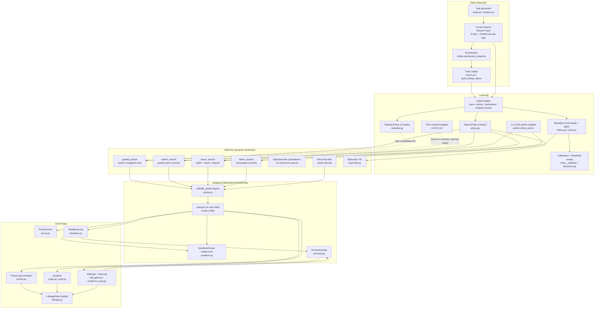
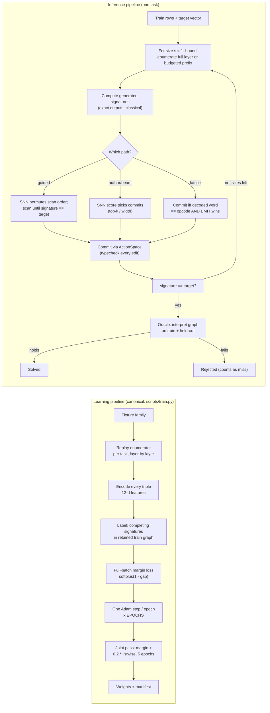
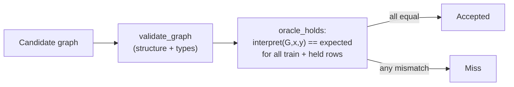
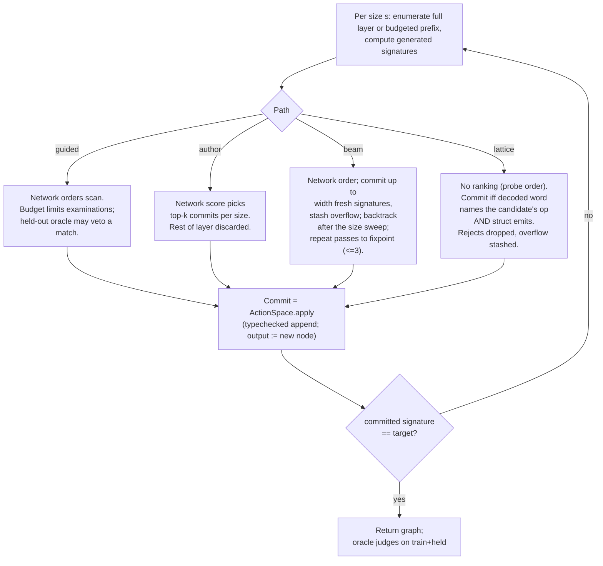
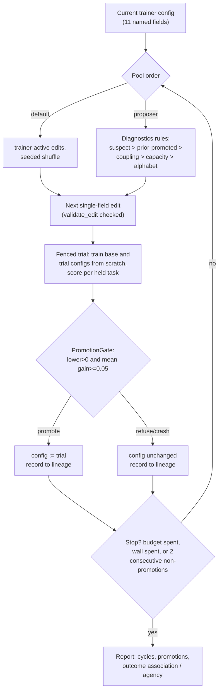

# rsi-programmer architecture: learning and inference, as implemented

This document was first written against `code-v40` (`f854a5e`). It
now describes the implementation after the 2026-10-17 review fixes
and links the issues that motivated those changes. Measurements made
before the current feature encoding and work counters are historical;
they are not current performance results.

Two facts frame everything below and are worth stating before any
detail:

1. **Candidate generation and candidate evaluation are always
   classical.** Guided, beam, and lattice inference enumerate a full
   search layer and compute each candidate's exact train-row output
   vector (its *signature*, Section 2) before consulting network
   outputs. Budgeted greedy author search may generate only a prefix
   of the layer in enumeration order. Networks never generate
   candidates; they rank or gate candidates generated by ordinary
   code. ([#70](https://github.com/Capsize-Games/rsi-programmer/issues/70))
2. **Acceptance is independent of the networks.** A program counts
   as solved only when the typed-DAG interpreter reproduces the
   frozen expected outputs on train and held-out rows
   (`TraceRecorder.oracle_holds`, `words.oracle_holds_words`,
   `bytecode.binary_holds`). Network scores never enter acceptance.

## 0. System map

## 1. Notation

A task is a frozen set of input rows
$R = \{(x_i, y_i)\}_{i=1}^{n}$ with expected outputs
$\mathbf{t} = (t_1, \dots, t_n)$, $n = 8$ train rows, plus 8
disjoint held-out rows with their own expectations. Inputs are
drawn from the grid $\{-4, \dots, 4\}^2$ for generated families
(`tasks.py: ROW_LO, ROW_HI = -4, 5`, rows sampled without
replacement across train and held). Programs are typed integer/
boolean expressions over inputs $x, y$, binary operators
$\mathrm{OPS} = \{+, -, \times\}$, comparisons
$\mathrm{CMP} = \{<, ==\}$, a ternary $\mathrm{select}(c, a, b)$,
and integer constants from
$\mathrm{CONSTS} = \{-2, -1, 0, 1, 2, 3, 4, 5\}$.

The *size* $|e|$ of an expression is its number of internal
operator nodes: terminals (inputs, constants) have size 0 and
$|\mathrm{op}(a, b)| = |a| + |b| + 1$,
$|\mathrm{select}(c, a, b)| = |c| + |a| + |b| + 1$. Search is
bounded by $|e| \le B$ (`max_tree_ops`, typically 4). One task in
`tasks._size_of` uses the same node-count convention when rebuilding
generated expressions ([#71](https://github.com/Capsize-Games/rsi-programmer/issues/71)).

## 2. Semantics: signatures, DAGs, and the checker

### 2.1 Signature semantics (`probe.signature`)

Every expression is evaluated pointwise over the rows. Writing
$\sigma_R(e) \in \mathbb{Z}^n$ (or $\mathbb{B}^n$ for comparisons)
for the output vector of $e$ on $R$:

$$
\sigma_R(x) = (x_1, \dots, x_n), \qquad
\sigma_R(y) = (y_1, \dots, y_n), \qquad
\sigma_R(c) = (c, \dots, c)
$$

$$
\sigma_R(\mathrm{op}(a,b))_i = \mathrm{op}\big(\sigma_R(a)_i,\,
\sigma_R(b)_i\big), \qquad
\sigma_R(\mathrm{select}(c,a,b))_i =
\begin{cases} \sigma_R(a)_i & \sigma_R(c)_i \\ \sigma_R(b)_i &
\text{otherwise} \end{cases}
$$

An expression *solves the train split* iff
$\sigma_R(e) = \mathbf{t}$ exactly. There is no partial credit in
acceptance; partial-match rates appear only as features
(Section 4).

Two properties matter later:

- **Pointwise composition.** If $\sigma_R(a) = \sigma_R(a')$ then
  $\sigma_R(C[a]) = \sigma_R(C[a'])$ for every context $C$. This is
  what makes signature dedup sound for train-fit *existence* - and
  only for that ([#54](https://github.com/Capsize-Games/rsi-programmer/issues/54)).
- **Train equality is not semantic equality.** $\sigma_R(a) =
  \sigma_R(a')$ says nothing about rows outside $R$. Held-out
  checking is a second, separate evaluation of the same recursion
  on different rows (`interpret` below), never an extrapolation
  proof.

### 2.2 Typed DAG form (`probe.lower_to_dag`, `validate_graph`)

Expressions lower to a hash-consed DAG: a node list where node $j$
is $(\mathrm{op}_j, \tau_j, \mathrm{args}_j)$, each arg is either
an input name $x$/$y$ or an index $< j$, plus constant nodes
carrying a value in CONSTS. Intering key
$(\mathrm{op}, r_l, r_r)$ makes structurally equal subtrees share
one node, so DAG size is at most tree size. `validate_graph`
checks, in order: exact field sets, known ops, per-op arity and
operand types ($\mathrm{Int}\times\mathrm{Int}\to\mathrm{Int}$ for
OPS, $\mathrm{Int}\times\mathrm{Int}\to\mathrm{Bool}$ for CMP,
$\mathrm{Bool}\times\mathrm{Int}\times\mathrm{Int}\to\mathrm{Int}$
for select), backward-only references (hence acyclicity), constant
range, and output reference validity. By default, final programs
must output an Int. `ActionSpace` opts out of that final-output
check while validating intermediate edits, so Bool comparison
nodes can feed a later `select`
([#67](https://github.com/Capsize-Games/rsi-programmer/issues/67)).

`interpret(G, x, y)` validates, then evaluates nodes in order in
unbounded Python integer arithmetic. `render_source` prints the
DAG as Python source text as a report artifact; nothing executes
it. Every graph mutation in search goes through
`ActionSpace.apply` (`actions.py`), which typechecks the extended
graph with `validate_graph` before returning it, and always sets
the output to the newly appended node. So every intermediate and
final graph in every search path is well-typed by construction;
the networks can only propose edits from the typed alphabet.

### 2.3 Acceptance

The frozen expected outputs are generated by evaluating the
generating expression (`tasks.generate_task`), or fixed in the
fixture; they are never derived from a candidate. This is the one
part of the stack with no learned component in the loop.

New tasks are accepted from the generating expression's own semantics,
without asking the evaluated enumerator to solve or generalize. Each
new task records a `generator_witness` and its selection filters; a
family records `generation_acceptance`. Nonconstant and nonidentity
training targets remain required, so this is still a selected synthetic
distribution. `search_filter=True` (CLI `--legacy-search-filter`) opts
into the older enumerator-and-held-confirmation filter and records that
choice. Existing frozen fixtures retain their original selection bias
and are not regenerated by this change ([#54](https://github.com/Capsize-Games/rsi-programmer/issues/54)).

## 3. The enumerator (`probe.enumerate_programs`)

Bottom-up enumeration by size. Let $L_s$ be the retained set of
Int expressions of size $s$ and $L^B_s$ the Bool set:

$$
L_0 = \{x, y\} \cup \{\text{const } c : c \in \text{given consts}\},
\qquad L^B_0 = \emptyset
$$

$$
\tilde L_s = \bigcup_{a=0}^{s-1}
\{\mathrm{op}(u,v) : \mathrm{op} \in \mathrm{OPS},\ u \in L_a,\
v \in L_{s-1-a}\}
$$

and optionally (branch families) comparisons into
$\tilde L^B_s$ analogously, plus
$\mathrm{select}(c, u, v)$ for $c \in L^B_{a}$, $u \in L_b$,
$v \in L_{s-1-a-b}$. The raw candidate count at size $s$ is
$3 \sum_a |L_a|\,|L_{s-1-a}|$ for arithmetic. Branch mode adds
$2 \sum_a |L_a|\,|L_{s-1-a}|$ comparison candidates and the
ternary select term. Without constants, branching, or deduplication, the
plain size-$s$ tree count is $2^{s+1}3^s C_s$, where $C_s$ is the
Catalan number: each of the $s+1$ leaves independently chooses x or y.

**Dedup.** With `deduplicate=True` (the default everywhere), each
layer keeps at most one expression per key
$(\mathrm{op}, \sigma_R(e))$, in generation order:
$L_s = \mathrm{dedup}(\tilde L_s)$. By pointwise composition
(Section 2.1) this preserves the existence of a train fit of each
size, but discards held-out-distinguishable equivalents, so the
enumerator is **incomplete as a search for held-out-correct
programs** ([#54](https://github.com/Capsize-Games/rsi-programmer/issues/54), with a size-1
counterexample). After each full layer is built, the layer is
scanned in generation order for the first $e$ with
$\sigma_R(e) = \mathbf{t}$ (optionally restricted to a root op);
that $e$ is returned.

Guided search can retain more than one lower-layer representative via
`alternatives_per_signature`; the default remains one. Reports count
retained and dropped alternatives and flag truncation. Alternative mode
uses a 10,000 candidate-signature budget by default, independently of the
scan budget; callers can set `signature_budget` explicitly, including
zero. This bounds expansion and does not claim held-out completeness.

**Work counters.** `signature_evaluations` is the canonical cost
across search paths: each candidate-signature computation counts
once, including work needed to materialize a layer. Reports retain
`tried` for compatibility and pair it with `tried_unit` and
`budget_unit`; those labels matter because legacy `tried` differs by
path. `operand_signature_evaluations` identifies signature work for
feature operands, `examined` counts scanned candidates, and
`committed_nodes` counts graph additions (guided search reports
the retained output graph). These counters count root vector
evaluations, excluding recursive subtree calls and neural work;
they are not a total CPU-operation or runtime measurement.
Trace collection observes enumeration in one pass without replay.
The optional `enumerate_programs_report` preserves the tuple API and
reports generated signature work, retained root-eligible examinations,
and the raw root-eligible match ordinal within the solving layer. Bool
comparison expressions contribute signature work but are not Int-root
examinations. Historical [gains charts](docs/gains/README.md) retain their
original measurements and cannot be read as current work comparisons.
Compare paths by
`signature_evaluations`, not by `tried` ([#53](https://github.com/Capsize-Games/rsi-programmer/issues/53)).

## 4. Network substrate math

All three networks are `SpikeForge` `TopologySpec` stage graphs
executed by `StageModule.step`. Within one step, stages run in
topological order; a stage's input is the **sum** of its inbound
edge outputs (`stage_module._gather`), where delayed edges read
the previous step's outputs. There is no gating or attention: the
merge operation is addition everywhere.

### 4.1 Neuron (`leaky` = snnTorch `Leaky`)

Each `leaky` stage is a first-order LIF population with fixed
$\beta = 0.9$, threshold $\theta = 1$, reset-by-subtraction.
Neither $\beta$ nor $\theta$ is a learned parameter anywhere in
this codebase. For input current $I_i[t]$ (the output of the
preceding linear stage, summed with any delayed feedback):

$$
\tilde U_i[t] = \beta\, U_i[t-1] + I_i[t], \qquad
S_i[t] = \Theta(\tilde U_i[t] - \theta) \in \{0,1\}
$$

$$
U_i[t] = \tilde U_i[t] - \theta\, S_i[t]
\quad\text{(subtract reset, with snnTorch's double-reset guard)}
$$

$\Theta$ has no derivative, so training substitutes the ATan
surrogate (snnTorch default, $\alpha = 2$) on the backward pass
only, with $u = \tilde U - \theta$:

$$
\frac{\partial S}{\partial \tilde U} \;:=\;
\frac{\alpha/2}{1 + (\pi \alpha u / 2)^2}
\;=\; \frac{1}{1 + (\pi u)^2}
$$

This derivative peaks at 1 at threshold and decays as
$u^{-2}$. It remains positive at every finite offset; a firing
rate of zero or one over a finite calibration batch does not by
itself show a zero surrogate derivative.

### 4.2 Constant-drive readout

Every drive presents the same input matrix $X$ for
$T = 6$ steps (`STEPS`). For `SearchPolicy`
($\text{Linear}_{12\to16} \to \text{LIF} \to \text{Linear}_{16\to1}$),
the hidden current is the constant $I = X W_1 + b_1$ at every
step, spikes $S[t]$ evolve by Section 4.1, and the score is the
mean readout:

$$
s(x) = \frac{1}{T} \sum_{t=1}^{T} \big(S[t]\, W_2 + b_2\big)
     = \bar r(x)\, W_2 + b_2, \qquad
\bar r(x) = \frac{1}{T} \sum_t S[t] \in [0,1]^{16}
$$

i.e. the ranker score is exactly an affine function of the mean
hidden spike-rate vector. All nonlinearity lives in
$\bar r(x)$. Learned parameters are exactly the linear stages'
weights and biases; optimization is Adam ($\mathrm{lr}=0.05$
default) with one full-batch step per epoch (Section 6).

`ModularPolicy` and `BitLattice` share a 13-d input
(12 features plus a scalar "gap" channel, Section 5), a shared
encoder $\text{Linear}_{13\to16} \to \text{LIF}$, parallel
linear+LIF heads, and a delayed feedback edge
$\text{st} \to \text{fb\_fc} \to \text{enc}$, so the encoder
current at step $t$ is $W_{enc} x + b + W_{fb}\, S_{st}[t-1]$.
Head outputs are read out as mean spike rates in $[0,1]$.

**State handling.** SearchPolicy starts every independent score
drive with fresh state; its snapshot still records temporal state
for compatibility. ModularPolicy also uses fresh state by default.
Sequence callers can request continuation explicitly with
`continue_state=True` ([#52](https://github.com/Capsize-Games/rsi-programmer/issues/52)).
Lattice scoring resets state for each scan. Independent candidate
batches therefore do not inherit state merely because their batch
sizes match.

## 5. Feature encoding (`policy.encode` and extensions)

Each candidate triple $(\mathrm{op}, u, v)$ at target size $s$ is
encoded as 12 floats. Most fields are classical functions of
signatures; the final two identify the candidate's ordinal in its
current layer. With $n = |R|$, target $\mathbf{t}$, bound $B$,
and candidate index $i$ (zero-based) in a layer containing $m$
triples:

| # | feature | definition |
|---|---|---|
| 0-2 | op one-hot | $\mathbf{1}[\mathrm{op} = \text{add/sub/mul}]$ |
| 3 | left size | $\lvert u \rvert / B$ |
| 4 | right size | $\lvert v \rvert / B$ |
| 5 | node size | $s / B$ |
| 6 | left hit | $\frac{1}{n}\sum_i \mathbf{1}[\sigma(u)_i = t_i]$ |
| 7 | left inside | $\frac{1}{n}\sum_i \mathbf{1}[\min\mathbf{t} \le \sigma(u)_i \le \max\mathbf{t}]$ |
| 8 | right hit | same for $v$ |
| 9 | right inside | same for $v$ |
| 10 | layer progress | $(i+1)/m$ |
| 11 | remaining | $1 - (i+1)/m$ |

The author path appends four more (`author.EXTRA`), scored by
separately evolved weights $\mathbf{w}$ and added to the ranker
score:

$$
s_{\text{author}} = s_{\text{policy}}(x_{0:12}) +
\sum_{j} w_j\, e_j, \qquad
\mathbf{e} = \big(\tfrac{|\text{nodes}|}{B},\ \text{gap},\
\mathbf{1}[\sigma(\mathrm{op}(u,v)) = \mathbf{t}],\
\mathbf{1}[u \text{ is } v]\big)
$$

The third author extra, `exact_flag`, is the literal answer to "does
this candidate solve the train split". It is an external classical
author bonus, not an SNN input. Its contribution can be disabled in
OOD benchmarks with `ablate_extra`; the report records which
`AUTHOR_EXTRA` fields were disabled. This supports per-field checks
for `nodes_per_bound`, `open_gap`, `exact_flag`, and `self_apply`
([#70](https://github.com/Capsize-Games/rsi-programmer/issues/70)).
The gap is

$$
\text{gap}(\mathcal{S}) = 1 - \max_{\sigma \in \mathcal{S}}
\frac{1}{n}\sum_i \mathbf{1}[\sigma_i = t_i]
$$

over a context set $\mathcal{S}$ of signatures from previously
committed/reachable lower-layer nodes; the current candidate layer is
excluded. Gap $=0$ iff $\mathcal{S}$ already contains an exact match.
Modular and lattice drives append this scalar as a 13th input
channel. Modular training uses lower-layer signatures; when gap
metadata is absent, the drive defaults explicitly to 1.0. Lattice
training and inference currently use the default constant 1.0.

For the additive author/beam bonus, `_score_order` fixes `gap` and
`nodes_per_bound` once per scored layer. They add the same offset to
every candidate, supplying no candidate-specific ordering signal.
Beam backtracking compares entries within a size bucket and recreates
the stash on every pass, so it does not compare these offsets across
layers or passes. `exact_flag` and `self_apply` can vary by candidate.
This does not describe the modular network's nonlinear gap input.

The scale-up ("rich") features are a fixed linear re-derivation
from the 12: $\text{depth-frac} = x_5$,
$\text{imbalance} = |x_3 - x_4|$,
$\text{joint-hit} = (x_6+x_8)/2$,
$\text{joint-inside} = (x_7+x_9)/2$, scored by centroid weights
(Section 6.6). `scores()` adds the stored bonus once, and `rank()`
orders those combined scores ([#55](https://github.com/Capsize-Games/rsi-programmer/issues/55)).

Features 10-11 now use the same per-layer ordinal at training and
inference: $(i+1)/m$ and its complement. The snapshot records
`FEATURE_ENCODING = "layer-ordinal-v1"` and rejects incompatible
encoding tags. The rich bonus weights are stored with the snapshot;
`scores()` adds the bonus once and `rank()` orders those combined
scores, so ranking does not double-count it ([#55](https://github.com/Capsize-Games/rsi-programmer/issues/55)).

## 6. Learning algorithms

### 6.1 Training data and labels

Teaching rows come from frozen fixtures. Trace enumeration
(`policy.replay_layers`, `traces.TraceRecorder`) and retained
train-signature graphs produce candidate groups. Four label schemes
exist, and they are not equivalent:

1. **Trace groups** (`SearchPolicy.trace_groups`): per task, only
   the solving layer, label
   $y = \mathbf{1}[\sigma(\mathrm{op}(u,v)) = \mathbf{t}]$.
   This label is exact: every program that solves the train split
   at that layer is positive.
2. **Completion groups** (`author._base_groups`): teaching rows cover
   each layer through the first solving layer. A separate train-only
   graph is expanded through the full task bound. Its nodes are
   $(s,\sigma)$; every raw candidate contributes edges to its nonterminal
   operand nodes before operator/signature deduplication chooses
   representatives
   for the next layer. Backward reachability starts from every
   target-signature node at every size within the bound. If
   $\mathcal{W}_s$ is the set of reached signatures at size $s$, label
   $y=\mathbf{1}[\sigma(\mathrm{op}(u,v))\in\mathcal{W}_s]$.
   This covers alternatives in the retained train-signature graph;
   it does not prove held-out correctness. A 50,000-candidate cap
   bounds evidence collection. An incomplete graph yields no labels,
   and the task is skipped rather than treating unknowns as negatives.
   `supervision="canonical"` retains the old first-solution-subtree
   labels as an explicit ablation control. Rich surrogate negatives also
   exclude exact-size completing intermediates, or omit negatives when
   their graph evidence is truncated
   ([#66](https://github.com/Capsize-Games/rsi-programmer/issues/66)).
3. **Contrastive groups** (`author.contrastive_groups`): author
   groups partitioned by the candidate's own op, keeping only
   partitions with both classes present and with nonzero variance
   in at least one of the four operand feature dims
   (`OPDIMS` = features 6-9). Same labels as (2); used by the
   operand-refinement and lattice paths.
4. **Modular groups** (`mgroups.modular_groups`): completion labels
   plus per-group metadata (candidate op index, solution op set,
   layer gap). One group per task layer.

For the lattice, each row additionally carries two independent
targets: its own op's 4-bit opcode (Section 7.5) as the bit-head
target, and the author label (2) as struct-gate membership.

### 6.2 The pairwise margin loss (ranker core)

For a group with positive index set $P$ and negative set $N$ and
scores $s_i$, SearchPolicy and ModularPolicy use this term; the
lattice uses the bounded-rate hinge in Section 6.5:

$$
\mathcal{M}(P, N) = \frac{1}{|P|\,|N|}
\sum_{p \in P}\sum_{n \in N}
\mathrm{softplus}\big(1 - (s_p - s_n)\big), \qquad
\mathrm{softplus}(z) = \log(1 + e^z)
$$

with gradient weight
$\partial \mathcal{M}/\partial (s_p - s_n) =
-\sigma(1 - (s_p - s_n))/(|P|\,|N|)$ ($\sigma$ the logistic
sigmoid): pairs
already separated by more than the margin 1 contribute almost
nothing. `SearchPolicy.fit` runs epochs of: zero grads, sum
$\mathcal{M}$ over all groups (each group weight 1 regardless of
size), backpropagate through $T=6$ unrolled steps with the ATan
surrogate, one Adam step. Groups missing either class are
skipped. There is no minibatching, no weight decay, no lr
schedule.

An optional contrast term acts on paired score vectors
$\mathbf{u}, \mathbf{v}$ from two tasks' aligned probe layers:

$$
\cos(\mathbf{u}, \mathbf{v}) =
\frac{\mathbf{u} \cdot \mathbf{v}}
{\sqrt{(\mathbf{u}\cdot\mathbf{u})(\mathbf{v}\cdot\mathbf{v})} + 10^{-8}},
\qquad
\mathcal{C} = \mathrm{relu}(\cos - 0.3) + \mathrm{relu}(0.1 - \cos)
$$

added as $\lambda \mathcal{C}$ ($\lambda = 1$ default). Note what
this actually optimizes: cosine is driven into the band
$[0.1, 0.3]$ - neither invariance ($\cos \to 1$) nor separation
($\cos \to 0$ or $-1$). Outside the band the penalty is linear in
cosine with constant-magnitude gradient direction; the band
endpoints are constants, not derived quantities.

### 6.3 Author joint pass (`author.train_author`)

`train_author(policy, fixture, epochs)` = `fit` on
trace-style author groups plus contrastive groups, then
`refine_operands`: for `JOINT_EPOCHS = 5` epochs, one Adam step on

$$
\mathcal{L} = \sum_g \mathcal{M}_g \;+\;
\lambda \sum_{g'} \mathcal{LW}_{g'}, \qquad
\mathcal{LW} = -\frac{1}{|P|}\sum_{p \in P}
\Big( s_p - \log \sum_j e^{s_j} \Big)
= \mathrm{logsumexp}(\mathbf{s}) -
\frac{1}{|P|}\sum_{p \in P} s_p
$$

with $\lambda = $ `JOINT_LAMBDA` $= 0.2$, $\mathcal{M}$ over the
author groups and listwise over contrastive groups. The listwise
gradient is $\mathrm{softmax}(\mathbf{s}) -
\mathbf{1}_P/|P|$: it maximizes the total softmax mass on the
positive set, which is the differentiable surrogate for
top-1-in-group that the margin alone does not optimize. The
canonical entry point `scripts/train.py` runs exactly this
(50 epochs of fit plus the joint pass) and writes weights and a
manifest.

### 6.4 ModularPolicy loss (`modules.ModularPolicy.fit`)

Four heads produce rates per candidate row: op rates
$o_i \in [0,1]^3$, left/right scalars $l_i, r_i \in [0,1]$, struct
rates $q_i = (q_i^{E}, q_i^{S})$. The combined choice score is

$$
c_i = o_i[\mathrm{op}_i] + l_i + r_i + q_i^{E}
$$

and the loss is the sum of five margins over the same $(P,N)$:
combined choice, the candidate's own opcode rate, left operand,
right operand, and EMIT. There is no within-row cross-entropy for
the opcode head; its argmax report is a not-directly-supervised
diagnostic. Left and right heads each produce one scalar per
candidate. STOP has no direct score or loss term, but it feeds back
through the encoder and can affect later outputs
([#65](https://github.com/Capsize-Games/rsi-programmer/issues/65)).

These are candidate-row scoring heads, not conditional choices of
operators and operands. `module_report` measures positive-versus-negative
pairwise preference for the exact five row scores used by the loss.
For each group and score $s$, the statistic is
$\frac{1}{|P||N|}\sum_{p,n}(\mathbf{1}[s_p>s_n]
+\frac12\mathbf{1}[s_p=s_n])$, then averaged over eligible groups.
Uniform ordering has expectation 0.5, including ties. The report gives
the group count. Opcode argmax and operand-signature top-1 remain
explicit diagnostics; their older ambiguous keys are deprecated aliases.

### 6.5 BitLattice training (`ltrain.train_lattice`)

Step by step:

1. **Init.** Encoder/struct/feedback weights may be copied from a
   modular snapshot by stage-name prefix (`load_encoder`); bit
   heads start fresh. Despite early design language about a
   frozen encoder, training is **joint**: `set_encoder_frozen` is
   never called in this path, because frozen-encoder gradients
   were measured at exactly zero (see step 2).
2. **Calibration** (`_calibrate`). Before fitting, calibration
   operates on the training-group slice and attempts to center b0..b3
   and both struct outputs (EMIT and STOP) near a 0.5 mean firing
   rate. It repeats the feedback-sensitive bias search for at most
   three cycles and reports convergence. After fitting, it measures
   all six rates and reports drift without resetting learned biases;
   arbitrary feedback networks are not assumed to have monotone
   calibration curves ([#57](https://github.com/Capsize-Games/rsi-programmer/issues/57)).
3. **Fit** (`fit_packs`, `epochs = 8` default). Per pack
   (contrastive group), six terms: for bit $j$,
   $\mathcal{H}_T$ between rows whose target bit is 1 vs 0, where
   the target word is the candidate's **own opcode**; for the
   struct gate, $\mathcal{H}_T$ of EMIT rate against author-label
   membership, and of STOP rate against $1 -{}$membership. If a
   bit's target is constant within the pack, the margin is
   replaced by squared-error regression to that constant. Pack
   loss:

   $$
   \mathcal{L}_{\text{pack}} =
   \operatorname{mean}(\boldsymbol{\ell}) +
   \lambda \max(\boldsymbol{\ell}), \qquad
   \boldsymbol{\ell} = (\ell_{b0}, \dots, \ell_{b3},
   \ell_{E}, \ell_{S}),\ \lambda = 0.2
   $$

   averaged over packs, one Adam step per epoch, state reset per
   pack. For rates averaged over $T$ firing steps, mixed-label heads
   use the one-spike hinge

   $$
   \mathcal{H}_T(P,N)=\frac{1}{|P||N|}
   \sum_{p\in P,n\in N}\max(0,1/T-(r_p-r_n)).
   $$

   Its attainable floor is zero. Once all pairs have a one-spike
   gap, this term supplies no further gradient toward saturation.
   Constant-target heads use squared error instead. The maximum is across
   six pack-aggregate head losses, not per-word errors. STOP is
   directly fitted and also affects later rates through feedback
   ([#56](https://github.com/Capsize-Games/rsi-programmer/issues/56)).
4. **Threshold tuning and evaluation** (`lprecision.refine`).
   Whole groups are split before fitting into training, calibration,
   and evaluation partitions. For homogeneous candidate-opcode groups,
   the seeded split preserves at least one training group per observed
   opcode. When each opcode has at least three groups, calibration and
   evaluation each receive every observed opcode. Sparse strata report
   incomplete coverage. Group counts and row counts remain distinct.
   On calibration groups, coordinate descent (2 rounds) tunes bit
   thresholds from $\{0\}\cup\{(k+0.5)/T:k=0,\ldots,T\}$, covering
   every discrete rate cut including always-on and always-off, to
   maximize word-exact rate. It then tunes struct margin
   $m \in \{0, -0.2, 0.2\}$ maximizing
   gate F1. Threshold ties retain their current value. No gradients
   are applied during tuning. The calibration report also measures
   whether word-exact AND EMIT agrees with membership, but does not
   optimize that joint metric. Reported evaluation metrics use the
   separate evaluation groups; calibration scores are tuning results,
   not an unbiased final estimate
   ([#58](https://github.com/Capsize-Games/rsi-programmer/issues/58)).

Decode (used both in reporting and in `lauthor`): bit
$\hat b_j = \mathbf{1}[r_j \ge \theta_j]$,
word $\hat w = \sum_j \hat b_j 2^j$, struct flag
$\mathbf{1}[r_E \ge r_S + m]$.

### 6.6 Non-gradient learners

- **Rich centroid weights** (`rich.fit_rich`): per group,
  $w_j \mathrel{+}= \bar x_j^{P} - \bar x_j^{N}$ over the four
  rich features (`RICH_LR = 1`), averaged over groups. This is
  the class-mean difference direction (an unnormalized Fisher-
  style linear probe), with no variance scaling. The serialized
  bonus is added once by `scores()` and used by `rank()`
  ([#55](https://github.com/Capsize-Games/rsi-programmer/issues/55)).
- **Author weight refinement** (`author.refine_author`): a
  $(1{+}1)$ evolution strategy on $\mathbf{w} \in \mathbb{R}^4$.
  Each round proposes
  $\mathbf{w}' = \mathbf{w} + \mathcal{N}(0, 0.1^2)$
  (reseeded deterministically per round) and accepts iff the
  lexicographic fitness
  $(\text{solved}, -\text{tried})$ strictly improves, evaluated
  by actually running author search on the given tasks. OOD
  reports label this as `task_train_rows` adaptation when the
  evaluation task's training rows are used to refine weights;
  `zero_adaptation` reports use no such refinement. Held-out
  labels are not passed to the refiner ([#64](https://github.com/Capsize-Games/rsi-programmer/issues/64)).
- **Weight perturbation** (`perturb` on all three networks):
  $\theta \leftarrow \theta + \sigma \varepsilon$,
  $\varepsilon \sim \mathcal{N}(0, I)$ with a seeded generator,
  applied to all parameters (lattice: head prefixes only,
  including struct - which is simultaneously classed as an
  "encoder prefix" for freezing and a "head prefix" for
  perturbation).

### 6.7 Snapshots and restore

Snapshots include the feature-encoding tag and restore onto a new
module with an optimizer rebound to the new parameters. All three
retain the recipient's Adam options by default; the explicit
`optimizer_from_snapshot=True` option adopts saved donor options.
None restore Adam moments or
step counters, so restore is a fresh-optimizer child copy, not an
exact training resume ([#51](https://github.com/Capsize-Games/rsi-programmer/issues/51)).
SearchPolicy snapshots also carry the serializable rich bonus.

## 7. Inference algorithms

All search paths share one skeleton: maintain retained levels
$L_0, L_1, \dots$ as in Section 3 (with per-task const terminals
joining $L_0$ when the task declares the `const` feature), then
generate candidates at the next size with `policy.layer_triples`.
Guided, beam, and lattice paths enumerate the full layer; budgeted
greedy author search can request only an enumeration-order prefix.
Each generated candidate's signature is computed classically before
the path's network decides examination or commitment. They differ in
exactly what the network controls:

### 7.1 Guided search (`search.guided_search`)

Per size: generate triples, intern them (materializing one graph
node per distinct $(\mathrm{op}, r_l, r_r)$ in the search
context's graph), build the deduped next level, encode all
triples, get a permutation $\pi$ from `policy.rank` (descending
score, ties stable in generation order), then scan in order
$\pi$. Guided search orders candidates by rank, but signature dedup
still removes lower-layer expressions that may differ on held-out
rows. An oracle hook can reject a train match that fails held-out
validation and resume the scan; it cannot restore candidates
removed by dedup ([#54](https://github.com/Capsize-Games/rsi-programmer/issues/54)).
The budget applies to candidate scans. `no-solution-within-bound`
means no solution was found in the bounded retained search space;
`budget-exhausted` means the scan limit stopped the search.
Returned graphs contain only the selected expression's nodes.

Layer construction and signatures are still computed before the
rank-ordered scan. `signature_evaluations` reports that work
separately from `examined` scans and the legacy `tried` counter.
Use `signature_evaluations` to compare with the enumerator: the
SNN changes examination order, not the signatures needed to build
a layer ([#53](https://github.com/Capsize-Games/rsi-programmer/issues/53)).
Because guided search eagerly builds and scores the layer,
`signature_evaluations` is invariant to ranker ordering. Work-cost
promotion therefore measures search-path cost, not ranking gains;
use scan-order or ranking metrics to assess those gains.

### 7.2 Greedy author (`author.author_search`)

Per size: score all triples with
$s_{\text{author}}$ (Section 5), then actually **commit** the
top-$k$ ($k = 3$ default) through `emit_edit`/`ActionSpace`,
each append verified by the typechecker and logged. Committed
expressions form the next level; everything else in the layer is
discarded, so this path is **incomplete**: if no needed
intermediate is in any size's top-$k$, the task fails even though
a within-bound solution exists. Returns solved the moment a
commit's signature equals the target. With `fallback=True`
(default), failure falls back to a full `guided_search` and the
result is relabelled `path="fallback"` - reports must (and
largely do) separate the two. Duplicate signatures are filtered
before committing. Reports distinguish `signature_evaluations`,
`examined`, and `committed_nodes`; the legacy `tried` field keeps
its path-specific unit.

### 7.3 Beam author (`author.beam_search`, `_beam_sweep`)

Per size, in descending author score: skip non-fresh signatures
(already committed anywhere), commit the first `width` fresh
ones, stash the remaining fresh ones with their scores. After
the size sweep, a backtrack phase drains stashes in FIFO (or
score) order, committing until the budget (denominated in
commits) is spent. Because backtrack commits at a low size
arrive after higher sizes were already scanned, the whole
scan+backtrack repeats for up to `MAX_PASSES = 3` passes,
stopping when a backtrack adds no new signature. Termination is
guaranteed by the pass cap and by signature freshness (each
commit consumes a previously unseen train-signature, of which
there are finitely many retained candidates). An optional
`widen` reruns the sweep from scratch at a larger width with the
remaining budget. Beam is incomplete in a softer sense than
greedy: width bounds *immediate* commits per size, but the stash
retains all fresh overflow, so with enough commit-budget it can
commit most of a layer - width controls ordering priority, not
total work. Signature computation cost is the full layer's in
every case. Budgets are labeled by `budget_unit`; compare paths
using `signature_evaluations`, not legacy `tried`
([#53](https://github.com/Capsize-Games/rsi-programmer/issues/53)).

### 7.4 Lattice author (`lauthor.lattice_search`)

Beam skeleton with the ranking removed: candidates are examined
in probe (generation) order, state is reset per scan, and a
candidate commits iff

$$
\underbrace{\sum_{j=0}^{3}
\mathbf{1}[r_j \ge \theta_j]\, 2^j}_{\text{decoded word}}
\;=\; \mathrm{OPCODE}(\mathrm{op}_{\text{candidate}})
\quad\wedge\quad r_E \ge r_S + m
$$

i.e. the four bit heads must collectively *name* the candidate's
own operator and the struct gate must emit. Named overflow goes
to the FIFO stash; unnamed candidates are dropped permanently
(never stashed), which is what makes misses capability verdicts
rather than budget verdicts. There is no fallback on this path.
`named_rate = named / max(examined, 1)` is reported, where both
counters exclude duplicate-signature skips. A `shuffle` ablation
mode replaces decoded words with seeded uniform words in
$\{0..15\}$ while keeping the struct gate, measuring how much of
the solve depends on naming versus sweep structure
(`selectivity.py` builds its report from this, plus an "echo
overlap": the fraction of lattice-named signatures that a beam
top-`width` selection on the same layers would also have
committed).

What the network contributes here is a binary filter, not a
ranking and not generation: the bit heads are trained to
recognize the op that features 0-2 already state as a one-hot,
so word agreement is largely a learned identity check on a
given input, and the selective pressure comes from the struct
gate's membership decision - the component measured to cap at
low F1 ([#56](https://github.com/Capsize-Games/rsi-programmer/issues/56),
[#58](https://github.com/Capsize-Games/rsi-programmer/issues/58)).

### 7.5 Word codec (`words.py`)

A 4-bit word alphabet (ISA v0):
$0{=}\text{add}, 1{=}\text{sub}, 2{=}\text{mul}, 3{=}\text{lt},
4{=}\text{eq}, 5{=}\text{select}, 6{=}\text{input},
7{=}\text{const}, 8{=}\text{stop}$; words 9-15 are reserved.
`pack`/`unpack` are LSB-first bit packing,
$w = \sum_j b_j 2^j$. A program is a flat word stream: opcode
word followed by ref-words (1 for input/const, 2 for binary ops,
3 for select), terminated by stop. Refs index the live table
$[x, y, \text{node}_0, \text{node}_1, \dots]$ as it grows; output
is the last Int node built. The assembled graph must pass
`validate_graph`.

Every opcode and operand word must be an integer in the range
0–15. Reference words intentionally index modulo the live table
size, and constant indices modulo the constant table size;
`stop` must be the final word, and a decoded program must
contain an Int output. `input` instructions consume a word and
do nothing. `oracle_holds_words` decodes and checks train+held,
returning False on any decode error.

### 7.6 Stack bytecode and VM (`bytecode.py`)

A validated DAG (add/sub/mul/const only, at most 255 nodes)
lowers node-by-node: pushes of inputs (`PUSH_X/Y`), constants
(`PUSH_IMM16`, little-endian signed), or earlier slot values
(`FETCH slot`), then the op, then `STORE slot`; finally push the
output and `HALT`. The VM keeps a value stack (limit 1024) and
256 zero-initialized slots, all arithmetic masked to 16 bits, result read as
signed two's complement via

$$
\mathrm{wrap16}(v) = (v \bmod 2^{16}) -
2^{16}\,\mathbf{1}[(v \bmod 2^{16}) \ge 2^{15}]
$$

**Correctness (this part checks out).** Reduction mod $2^{16}$
is a ring homomorphism for $+, -, \times$, inputs are masked on
push and immediates are stored mod $2^{16}$, so by induction
over the node order every slot holds
$\llbracket \text{node} \rrbracket \bmod 2^{16}$ and

$$
\mathrm{VM}(G, x, y) =
\mathrm{wrap16}\big(\llbracket G \rrbracket(x, y)\big)
$$

for every bytecode-supported graph. Hence `binary_holds`
(equality with unbounded expected outputs) holds iff the true
value lies in $[-2^{15}, 2^{15})$ on every row—the check
simultaneously verifies value and range. A `FETCH` before its
slot is stored reads the defined initial value, zero. Stack
underflow raises `ValueError`, and `binary_holds` treats
malformed execution as a failed oracle check
([#67](https://github.com/Capsize-Games/rsi-programmer/issues/67)).

### 7.7 SpikeDecoder (`decoder.py`, standalone)

A fixed winner-take-all decoder from named spike populations
(struct, op, left/right pointers, cond, value - each a
$T \times \text{population}$ train) to one `ActionSpace` edit.
For each population, rates $\bar r$ are step means; the winner
is $\arg\max$ subject to $\bar r_{\text{top}} \ge$ threshold
(0.5 default for all three kinds) and a margin over the
runner-up strictly greater than `tie_eps` $= 10^{-6}$;
otherwise the decode rejects with a reason (`sub-threshold`,
`tie`, `unknown-token`, `stop`, `type-mismatch`) instead of
guessing. Struct must decode to `emit`, then op, then pointers,
with static Int/Bool types checked against a caller-supplied
kind table. It learns nothing. As wired today, no search path
calls it: the searches consume `rank()`/head rates directly, so
this is a tested boundary component, not a stage in synthesis.
Pointer failures of every kind are reported as `tie`, whatever
the actual reason.

### 7.8 Sandbox judging (`sandbox.py`, `headless.py`)

For headless acceptance, the solved graph is first minimized
(post-order reachability prune from the output, remapping
indices) - necessary because guided/beam graphs carry dead
frontier nodes past the sandbox's 64-node cap. `SandboxRunner`
prescreens the JSON-serialized graph+claim for denied substrings
(`oracle`, `exec`, `open(`, ... - string matching on a payload
the candidate never executes, so this is hygiene theater more
than a boundary), node/byte caps, and `validate_graph`. It then
spawns a disposable subprocess (scrubbed environment, isolated
cwd, CPU rlimit 5s, wall timeout 5s) that re-runs the *same*
`probe.interpret` on the submitted rows; the supervisor
recomputes outputs itself, rejects on child/supervisor mismatch
or on a candidate claim whose claimed outputs differ
("forged-completion"), and hashes the canonical JSON graph as
its lineage id. The independence here is process and
environment isolation, not implementation diversity: both sides
run identical interpreter code. The final solve bit still comes
from `oracle_holds` against frozen expectations, evaluated
supervisor-side.

## 8. Outer loops: evolution, screening, promotion, self-edits

### 8.1 Evolution (`evolve.PolicyLoop`, `scale.ScaleUp`, `pool`)

Populations (`POP = 4` in evolve; scale runs 3 founders then
elite+3 children) of policies, founded as {untrained, trace-fit,
author-fit, perturbed variants}. Children alternate "gradient"
(8 epochs of `fit` after restore, using a fresh optimizer bound
to the restored child weights; Section 6.7) and "perturb"
($\theta + 0.1\,\mathcal{N}(0, I)$). Selection keeps the
lexicographic best as elite (same object, aliased) and spawns
from the Pareto front under dominance
$\mathbf{a} \succ \mathbf{b} \iff
(\forall k: a_k \ge b_k) \wedge (\exists k: a_k > b_k)$.

Fitness components as implemented:

$$
\text{correctness} = \frac{\#\text{ tasks solved and
oracle-held}}{\#\text{ tasks}}, \qquad
\text{efficiency} = \max\Big(0,\ 1 -
\frac{\sum \text{signature\_evaluations}}{\text{baseline signature-work sum}}\Big)
$$

$$
\text{recovery}_{\text{evolve}} =
\begin{cases}
\max\big(0,\ 1 - \frac{\text{signature-work}_{\text{noisy}} -
\text{signature-work}}{\text{task baseline signature-work}}\big) & \text{noisy copy solves}\\
0 & \text{otherwise}
\end{cases}
\qquad
\text{recovery}_{\text{scale}} =
\frac{\#\text{ noisy solves}}{\#\text{ tasks}}
$$

plus *refinability* (fraction of 2 probe tasks solved after
EXTRA-weight refinement) in evolve's ordering key, and
*hard_benefit* in scale: the fraction of selection sets (750
hard negatives + 1 positive, positive last) where
policy-score-plus-rich-bonus ranks the positive first. Ordering
is lexicographic on the components (`_fitkey`, `fitkey4`), while
Pareto dominance uses a subset - the two rankings can and do
disagree, and both drive selection in different lines of the
same function.

Evolution now excludes screen-skipped children from measured
selection and reports their fitness as provisional
([#62](https://github.com/Capsize-Games/rsi-programmer/issues/62)). The task
recovery term uses canonical signature work against that task's
baseline, bounded to $[0,1]$. A remaining limitation is that a
failed evaluation gate still returns zero selection fitness for
the population member; this can erase partial ordering among
near-misses ([#63](https://github.com/Capsize-Games/rsi-programmer/issues/63)).

### 8.2 Proxy screening (`proxy.ProxyScreen`)

For each candidate seed, the proxy trains briefly on the first
2 shadow tasks' groups (`PROXY_EPOCHS = 4`), averages over seed
offsets, and scores mean per-task gain on the remaining shadow
tasks, where

$$
\text{gain} = \begin{cases}
\dfrac{\text{signature-work}_{\text{plain}} -
\text{signature-work}_{\text{guided}}}
{\text{signature-work}_{\text{plain}}} & \text{solved} \\[6pt]
-1 & \text{otherwise}
\end{cases}
$$

Full eval trains 50 epochs on all shadow groups and measures the
same gain on novel tasks. Fidelity between proxy and full
rankings over shared candidate ids is pairwise agreement with
ties at half credit,
$\mathrm{agree} = (C + T/2)/(C + D + T)$ over concordant,
discordant, and tied pairs - a pairwise accuracy, not Kendall's
$\tau$. The proxy may name a winner only when agreement
$\ge 0.8$ on at least 3 pairs ("proven"); 3 pairs is 3
candidates, so proof can rest on very little evidence. The gain
uses `signature_evaluations` where available, with legacy `tried`
fallback for older records. `screen` uses each candidate's configured
seed values ([#68](https://github.com/Capsize-Games/rsi-programmer/issues/68)).

### 8.3 Promotion gate (`promote.PromotionGate`)

Given paired per-task scores $\mathbf{b}$ (base) and
$\mathbf{c}$ (candidate), diffs $d_i = c_i - b_i$:

$$
\bar d = \frac{1}{n}\sum_i d_i, \qquad
\text{lower} = Q_{\alpha}\big\{\bar d^{*(1)}, \dots,
\bar d^{*(2000)}\big\}
$$

where each $\bar d^{*}$ is the mean of $n$ diffs resampled with
replacement (percentile bootstrap, sorted index
$\lfloor \alpha \cdot samples \rfloor$). The configurable
`min_pairs` defaults to 3. Score arrays are declared to represent
paired independent task-level observations, but this interface has
no task or cluster identifiers with which to check that declaration.
Nonfinite scores, statistics, and spend values are rejected.
Promotion requires zero reported safety failures, a lower bound
above zero, mean gain at least `min_gain` (default 0.05), and spend
within measured budgets. SelfGate receives held scores only: safety
failures and token spend are unavailable and supplied as zero; wall
time is measured. The gate does not perform cluster resampling
([#59](https://github.com/Capsize-Games/rsi-programmer/issues/59)).
Failure clusters map to a curriculum list
(count by `kind`, ranked by count), which `families.
curriculum_params` converts by keyword rules into generated-
family parameters. New curriculum tasks use the generating expression's
semantics for acceptance. Evaluated-search filtering is an explicit
legacy option, described in Section 2.3
([#54](https://github.com/Capsize-Games/rsi-programmer/issues/54)).

### 8.4 Self-edits and the closed loop (`edits`, `proposer`,
`self_gate`, `loop_trainer`, `scripts/rsi_loop.py`)

Edits are data: `{op: "set", field, value}` with values drawn
from small enumerated sets (`edits.FIELDS`); the alphabet
structurally cannot name gate/sandbox/lineage/validator/oracle
fields. `SelfGate.propose` runs the trainer twice (base, trial)
in separate workdirs, pairs the returned held scores, applies
Section 8.3, and records every outcome to lineage, decrementing a
fixed trial budget. Invalid or insufficient score evidence is
refused and recorded.

The default trainer (`loop_trainer.train_scores`) builds a
`SearchPolicy` from the config's hidden/steps/lr, fits 5 epochs
on shadow trace groups, runs the joint pass with the config's
joint_lambda/joint_epochs, then scores guided search per task
on shadow (train) and the v2 family (held). A task receives zero
unless search returns a graph that passes the independent oracle
on both train and held rows; an oracle callback also lets guided
search resume after a held-out failure. A held-correct task is
scored by canonical candidate-signature work

$$
s = \begin{cases}
0 & \text{miss}\\
2 - \dfrac{\log_{10}(\text{signature\_evaluations} + 1)}{\log_{10}(10^9)}
& \text{solved}
\end{cases}
$$

Lower work yields a higher solved-task score. The fixed $10^9$
normalization reference does not bound eager signature work, which
can exceed the candidate-scan budget; therefore, a held-correct
task is not guaranteed to score above a miss, whose score is zero.
The default CLI restricts its proposal pool to the five
fields read by this trainer (`hidden`, `steps`, `lr`,
`joint_lambda`, `joint_epochs`); generic `RsiLoop` callers retain
the full edit alphabet unless they supply an active-field set
([#61](https://github.com/Capsize-Games/rsi-programmer/issues/61)). The
proposer still uses diagnostic priority rules; custom proposals
are subject to the same active-field filter only when configured.

The loop reports a descriptive `outcome_association` of measured
gains grouped by promotion decision. The legacy `autonomy` key is
an alias for this descriptive statistic; neither value establishes
that the loop caused the gain. Refused trials retain their measured
mean gain. Missing or invalid gains are excluded from association and
agency summaries rather than receiving an imputed zero. Singleton groups
are counted in the report. Agency summaries mark a one-record
generation as `non-informative`, because it has no pairwise
diversity measurement; such a generation does not establish
convergence.

$$
\text{outcome association} = \eta^2 =
\frac{\sum_h |G_h|\,(\bar y_h - \bar y)^2}
{\sum_i (y_i - \bar y)^2}, \qquad
\text{agency}_g = \big(\text{mean pairwise }
\lVert \mathbf{w}_a - \mathbf{w}_b \rVert_2,\
\max \text{fit} - \min \text{fit},\ \text{direction}\big)
$$

plus integration divergence: mean absolute readout change when
cross-partition stages are zeroed. These are descriptive
statistics, not measures of causal autonomy or agency
([#60](https://github.com/Capsize-Games/rsi-programmer/issues/60)).

### 8.5 Lineage (`lineage.LineageStore`)

A sqlite store of missions and command intents
(canonical-JSON payload plus SHA-256 digest), used as the
Pareto archive for evolution and the audit trail for gates.
Intent writes are insert-only and return the exact inserted
record. The store prefixes commands with its session UUID.
`PolicyLoop.run` and `ScaleUp.evolve` also create a fresh logical
run UUID for each invocation, so repeated runs on the same
instance preserve earlier records. Duplicate commands within
one logical run still reject
([#69](https://github.com/Capsize-Games/rsi-programmer/issues/69)).

## 9. Current contracts

- **Type safety of every emitted graph.** All construction goes
  through `ActionSpace.apply` or `lower_to_dag` plus
  `validate_graph`; references are backward-only, so graphs are
  acyclic and operands correctly typed. Final validation requires Int
  output by default; ActionSpace explicitly permits Bool intermediate
  outputs ([#67](https://github.com/Capsize-Games/rsi-programmer/issues/67)).
- **Acceptance independence.** Solved means exact equality on
  train and held rows under the frozen expectations (Sections
  2.3, 7.8); no network score, vote, or self-report can promote
  a program.
- **Search acceptance is oracle checked.** Guided search can retry
  after a held-out rejection, but train-signature dedup can still
  remove held-distinguishable lower-layer expressions; it is not
  complete for held-out-correct programs ([#54](https://github.com/Capsize-Games/rsi-programmer/issues/54)).
- **Bytecode arithmetic** exactly implements wrap16 of the
  unbounded semantics for supported ops (Section 7.6).
- **Determinism of data.** Fixture generation is seeded and
  byte-stable, and split hashes are recorded; the *bias* in
  which tasks survive generation is separate
  ([#54](https://github.com/Capsize-Games/rsi-programmer/issues/54)).
- **Fencing of self-edits.** The edit alphabet cannot name the
  judge components, malformed edits are refused before budget
  is spent, and trainer crashes roll back (`self_gate.py`).

## 10. Issue history

The issues below were filed on 2026-10-17. They record the
original claims and motivation; the descriptions are historical,
not a declaration that every defect remains in the current code.

| Issue | As-filed defect | Where the math shows it |
|---|---|---|
| [#51](https://github.com/Capsize-Games/rsi-programmer/issues/51) | restore() orphans optimizer; post-restore training is a no-op | §6.7 |
| [#52](https://github.com/Capsize-Games/rsi-programmer/issues/52) | temporal-state leakage makes scores history-dependent | §4.2 |
| [#53](https://github.com/Capsize-Games/rsi-programmer/issues/53) | `tried` is four units; enumerator counts full solving layer; guided budget unenforced | §3, §7.1-7.4 |
| [#54](https://github.com/Capsize-Games/rsi-programmer/issues/54) | signature dedup incompleteness; task generation filtered by evaluated search | §3, §8.3 |
| [#55](https://github.com/Capsize-Games/rsi-programmer/issues/55) | train/inference feature-encoding mismatch | §5 |
| [#56](https://github.com/Capsize-Games/rsi-programmer/issues/56) | lattice margin ≥ dynamic range; joint term not per-word; STOP contradiction | §6.5 |
| [#57](https://github.com/Capsize-Games/rsi-programmer/issues/57) | bias calibration invalidated by delayed feedback | §6.5 |
| [#58](https://github.com/Capsize-Games/rsi-programmer/issues/58) | threshold sweep on fitted data, reported as held-out | §6.5 |
| [#59](https://github.com/Capsize-Games/rsi-programmer/issues/59) | gate is not a cluster bootstrap; n=1 degeneracy; dead safety/token clauses | §8.3 |
| [#60](https://github.com/Capsize-Games/rsi-programmer/issues/60) | autonomy/agency metrics degenerate as wired | §8.4 |
| [#61](https://github.com/Capsize-Games/rsi-programmer/issues/61) | 13/23 self-edits causally inert in default trainer | §8.4 |
| [#62](https://github.com/Capsize-Games/rsi-programmer/issues/62) | screen-skip fabricates child fitness from parent | §8.1 |
| [#63](https://github.com/Capsize-Games/rsi-programmer/issues/63) | fitness zeroing erases partial credit; recovery mis-scaled | §8.1 |
| [#64](https://github.com/Capsize-Games/rsi-programmer/issues/64) | author weights refined on evaluation tasks | §6.6 |
| [#65](https://github.com/Capsize-Games/rsi-programmer/issues/65) | modular head losses vs reported head metrics mismatch | §6.4 |
| [#66](https://github.com/Capsize-Games/rsi-programmer/issues/66) | canonical-solution labels mislabel valid alternatives | §6.1 |
| [#67](https://github.com/Capsize-Games/rsi-programmer/issues/67) | decoder/VM boundary gaps; Bool output passes validate_graph | §7.5-7.6, §2.2 |
| [#68](https://github.com/Capsize-Games/rsi-programmer/issues/68) | proxy screen ignores seed values | §8.2 |
| [#69](https://github.com/Capsize-Games/rsi-programmer/issues/69) | lineage overwrites across runs | §8.5 |
| [#70](https://github.com/Capsize-Games/rsi-programmer/issues/70) | exact_flag/gap answer channels confound authorship claims | §5 |
| [#71](https://github.com/Capsize-Games/rsi-programmer/issues/71) | `tasks._size_of` double-counts child roots | §1 |
