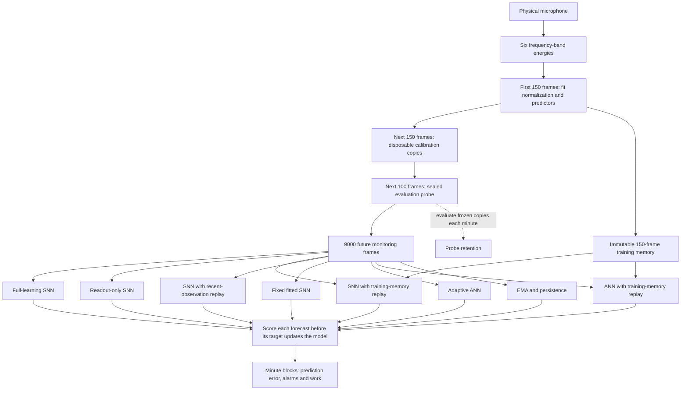

# Audio learning and training memory

The frozen experiment is `fixtures/audio_continual_v1.json`, committed in
`e29ca58` before its measurements. It compares nine predictors on the same
six-band microphone features. All SNN arms receive the same initial fit;
readout-only learning begins after that fit. The ANN uses continuous
activations in the corresponding predictor.



The probe is never used for training, replay, normalization, threshold
selection or model selection. Each probe evaluation uses reset copies with
learning and memory writes disabled. Calibration updates are discarded.
The fixed reference's parameters remain unchanged during monitoring.

Memory replay occurs after every 300 online training targets, including
warmup learning. The first replay is on monitoring frame 301. Each pass
uses 150 observations and 149 targets in a transient copy, then copies
parameters back before the next forecast. The live temporal state remains
in place. Recent-memory SNN receives the same replay work on its last 150
monitoring observations; memory ANN uses the original training examples.
These controls distinguish older-example retention from extra updates and
from a generic neural learning effect.

Run the bounded prospective comparison with:

```bash
.venv/bin/python -m scripts.fan_microphone start --variant continual
```

This creates a new private session and stops after 30 monitoring minutes.
The existing source and gain settings are used. Exact feature traces,
forecasts and parameter snapshots stay outside Git. Independent arithmetic
audits run at monitoring minutes 0, 1, 2, 4, 8, 16 and 30. A stopped or
failed capture must be inspected before any restart.

After capture stops, `scripts.measure_audio_continual` replays its exact
9,400-frame fit/calibration/probe/monitor prefix for seeds 0, 1 and 2. The
prospective replay requires agreement with the online seed-0 summary.
Retrospective replay instead requires seed 0 to reproduce the original
five arms' published first-30-minute totals. These stages are reported
separately; three seeds on one recording are not independent recordings.

Reports retain all arms, minute blocks, probe checkpoints, update counts,
replay work and processing time. Cumulative MSE is summed squared error
divided by summed band targets. Probe changes compare each arm with its
own starting probe error. Prediction error and observed alarms do not
establish fan-fault detection or chip energy.

The separate [prediction-inversion diagnostic](
audio-prediction-inversion-result.md) preserves the effect of replacing
predictions with their complements. It does not change this experiment's
predictors or use its probe to select a transform.
