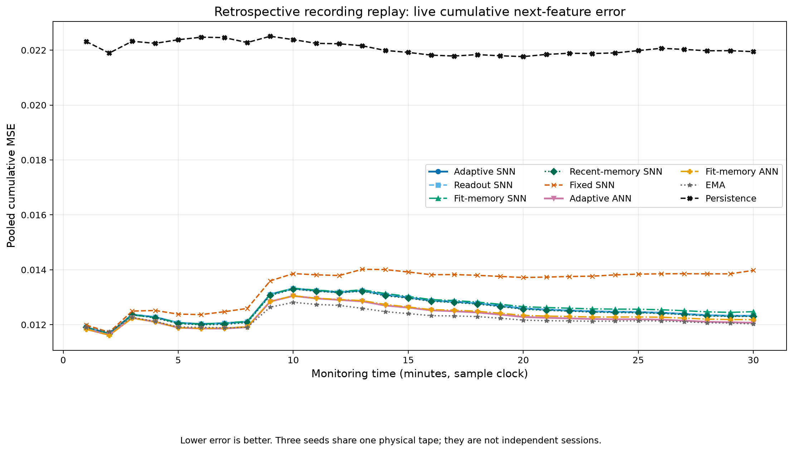
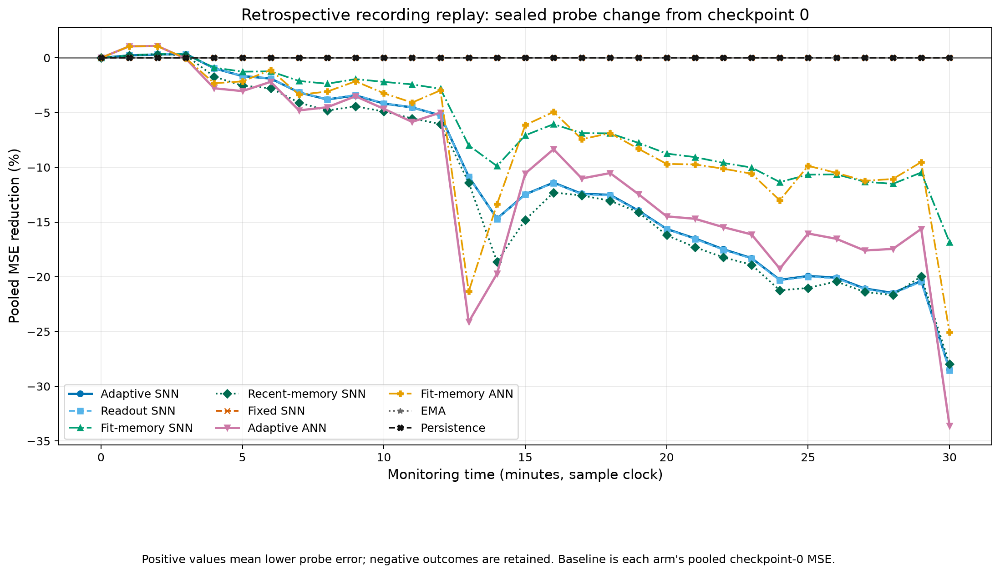

# Audio encoder and training-memory comparison

Replaying the preserved first 30 monitoring minutes across seeds 0, 1 and
2 finds a retention tradeoff. Training-memory SNN has 9.057% lower final
probe error than full-learning SNN, but 1.203% higher live prediction
error. Its probe error still increases 16.830% from its own starting
value. Full encoder learning and readout-only learning are nearly tied.
ANN and EMA retain lower live error than every tested SNN arm.

This is a retrospective diagnostic on one previously examined microphone
recording. Three model seeds are not three independent recordings.
The recipe was frozen in `e29ca58`, before this replay, with protocol
SHA256 `ff4a161882904aca6ba31a8498a859a1347addaa289e989ec0ea1e231a70fb58`.
The measured implementation is `e87bd50`; its exact source fingerprints
and input-prefix fingerprint are retained in the
[report](../artifacts/audio-continual-retrospective-20261018/report.json).
No parameters were trained on the probe, and the recipe was not tuned
during this replay. The original probe outcomes had already been examined
before this experiment was designed.

| Predictor | Live MSE | Final probe MSE | Probe error increase from own start |
|---|---:|---:|---:|
| Full-learning SNN | 0.012324648 | 0.015008609 | 28.465% |
| Readout-only SNN | 0.012325281 | 0.015017090 | 28.538% |
| Training-memory SNN | 0.012472920 | 0.013649331 | 16.830% |
| Recent-memory SNN | 0.012302198 | 0.014952738 | 27.987% |
| Fixed fitted SNN | 0.013978033 | 0.011683025 | 0% |
| Adaptive ANN | 0.012068845 | 0.015660326 | 33.607% |
| Training-memory ANN | 0.012181815 | 0.014660948 | 25.081% |
| Five-second EMA | 0.012026208 | 0.012129598 | 0% |
| Persistence | 0.021945711 | 0.022270380 | 0% |

All MSEs pool squared error and band-target counts across the three seeds.
Each seed uses exactly 9,000 monitoring frames: 8,975 scored frames,
53,850 band targets and 1,795 scored seconds. Pooling repeats those same
physical targets for three parameter seeds; it does not supply additional
physical observations. The first block scores 275 frames and the next 29
blocks score 300 each. All 31 probe checkpoints remain in the report,
with 75 scored frames and 450 band targets per seed at each checkpoint.

Full-learning SNN lowers live error by 11.828% relative to fixed SNN, but
has 2.120% more error than adaptive ANN and 2.482% more than EMA.
Readout-only SNN has 0.00513% more live error than full-learning SNN.
The full-learning advantage is below 0.009% in every seed, while both
methods lose retention on the sealed probe. This recording provides
little support for the extra encoder learning work.

Recent-memory SNN lowers live error by 0.182% relative to full-learning
SNN, while training-memory SNN raises it by 1.203%. Training memory
reduces final probe error by 9.057% relative to full-learning SNN;
training-memory ANN also reduces its corresponding ANN probe error,
by 6.382%. Retention therefore responds to replay in both architectures.
Neither memory arm improves its final probe error over its own start.
These results do not establish an SNN-specific advantage.

The memory arms receive 29 replay passes per band, each with 150 training
observations and 149 targets. Across six bands, replay adds 25,926 updates
to the 54,888 fit/online updates: **47.234% more updates**. Each memory
bank holds 150 six-band examples, or 900 normalized values. Each neural
arm has 222 trainable parameters. Calibration-copy and frozen-probe-copy
work is reported separately from fit/online/replay work. Processing time
for all nine arms averages 20.816 seconds per seed inside `observe`;
this excludes feature extraction and JSON I/O. The entire replay command
took 70.147 seconds. These host timings and logical counts do not measure
chip memory or energy.

All three independent trace-arithmetic audits pass. Seed 0 reproduces
the original five arms' published first-30-minute counts and squared
errors. A separate aggregate check validates 5,994 numeric comparisons,
including all plotted values, per-seed contributions, denominators and
derived replay-work counts. Both rendered charts were inspected.
The reproducible verifier corrects the first receipt's check counter:
that counter included 36 conditional work checks that were not performed.
The reported MSEs, plotted data and successful comparisons are unchanged.
The exact logs and source receipts are under
[`artifacts/audio-continual-validation-20261018/`](
../artifacts/audio-continual-validation-20261018/).

Before measurement, **128 affected tests pass in 25.868 seconds**,
including the original audio/sensing checks, memory isolation, matched
initialization, a full 9,000-monitor-frame synthetic production trace,
and terminal-audit ordering. Failed and corrected test runs are retained.
A subsequent fresh microphone startup exposed a monitor-zero auditor
boundary error and stopped before recording any monitoring outcomes;
its separate failure receipt is preserved. It does not invalidate this
completed retrospective replay. Corrected startup verification and the
fresh prospective comparison are separate evidence scopes.
The boundary repair in `5ccb0a5` passes 131 affected tests in 27.035
seconds. Its auditor also validates the preserved failed startup prefix
and all three completed retrospective traces in 4.155 seconds, without
training models or modifying the original results.
The separately named corrected capture uses the same frozen recipe and
source `5ccb0a5`. Its start and first-minute audits pass; the latter covers
700 total fit/calibration/probe/monitor frames. The SNN arms' fitted
parameters match, the reference remains unchanged, and the microphone
signal passes quality checks. This verifies startup only. Its full
30-minute prospective outcomes are pending.

The [experiment description](audio-continual-comparison.md) contains the
implemented flow and start command. The sealed probe stays out of all
training and memory writes. Raw PCM is discarded; exact feature traces,
forecasts, normalization vectors and learned parameters remain private.
There are no independently logged fan faults, independent-session
detection results or hardware-energy measurements. Issue #86 remains open.
