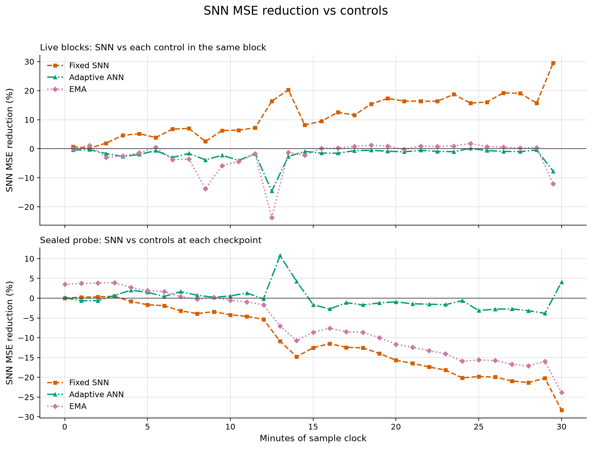

# First 30 minutes of live microphone learning

The adaptive SNN predicts the ongoing audio better than its fitted,
frozen reference, but worse than ANN and EMA. Its error on the original
sealed probe increases substantially. The first 30 minutes therefore show
an adaptation gain with a retention loss, without an SNN-specific advantage
over the live controls.

## Measurement scope

This report uses exactly the first 30 complete monitoring blocks and
sealed-probe checkpoints 0 through 30 from the original physical microphone
session. It follows the initial 30-second fit, 30-second calibration and
20-second probe collection. The scope is 9,000 monitoring frames at the
nominal sample-derived clock, not a measured hardware-timestamp duration.
The five-second warmup leaves 8,975 scored frames, 53,850 correlated band
targets and 1,795 scored seconds.

Capture had reached 9,205 monitor frames when the report was exported.
Those later frames do not enter these totals or the checkpoint-30 probe.
The session continues without a restart or parameter/recipe change.

## Live prediction errors

MSE is averaged over the six normalized frequency-band targets. Each arm
receives the same frames and is scored before any update.

| Predictor | Pooled live MSE | Observed alarms/minute |
|---|---:|---:|
| Adaptive SNN | 0.012324833 | 0.368 |
| Fixed SNN | 0.013980088 | 0.435 |
| Adaptive ANN | 0.012068902 | 0.435 |
| Five-second EMA | 0.012026208 | 0.401 |
| Persistence | 0.021945711 | 1.939 |

These are observed alarms, without labels identifying true faults or false
alarms. Pooled MSE uses summed squared errors divided by summed feature
targets; it does not average block percentages.

| SNN compared with | Live SNN MSE | Checkpoint-30 probe SNN MSE |
|---|---:|---:|
| Fixed SNN | 11.840% lower | 28.330% higher |
| Adaptive ANN | 2.121% higher | 4.052% lower |
| EMA | 2.483% higher | 23.842% higher |
| Persistence | 43.839% lower | 32.549% lower |

All pairwise percentages use the corresponding control's MSE as the
denominator: `100 * (control_mse - snn_mse) / control_mse` is positive when
SNN error is lower. The probe column compares arms at the same checkpoint.

## Retention on unchanged inputs

The sealed 20-second probe never updates the live models. At checkpoint 30,
adaptive SNN probe MSE is 0.015021563, versus 0.011705402 at checkpoint 0:
**28.330% higher error**. ANN probe MSE rises from 0.011720954 to 0.015655913,
or **33.572% higher error**. Fixed-SNN, EMA and persistence probe metrics
are identical across all 31 checkpoints.

The SNN's input weights and readout both change: all 72 input weights,
all 72 input biases, 36 readout weights and six output biases differ from
monitoring start. The fixed model changes none of those parameters. These
counts establish active updates; they do not establish useful fault sensing.

The [adaptation and retention chart](../artifacts/audio-live-session-20261018/minute-030/chart/learning-change.png)
retains both adaptive neural models' changes. The
[absolute-error chart](../artifacts/audio-live-session-20261018/minute-030/chart/audio-progress.png)
includes all five predictors. Exact values and per-minute comparisons are
in the [report JSON](../artifacts/audio-live-session-20261018/minute-030/report.json).

## Source and verification

The live runtime is commit
`aa5057289f58720b6f76d7ff8fca6bf8bb15020c`. Reporting code is
`dc9d953b660346e3cd18d7aaffb84411b455ae35`. The runtime file hashes still
match the sources covered by the pre-start affected checks.

Protocol SHA-256:
`ef7019083c0fcb24f3477a8384a5b3deccd260fd1ad9f7ef1d133c433b065561`.
Fitted reference fingerprint:
`1c56faa17c45f6f3ba43d053637953e414f4ace0d0de42673b5abcaaca98385d`.
The reference is unchanged at every selected checkpoint.

The runner's next scheduled arithmetic audit, at 32 monitoring minutes,
passed over 10,000 total frames in 0.832 seconds while holding its builder
lock. That audit includes every first-30-minute frame. Its 32-minute scope
is retained explicitly; no 31st/32nd-minute measurement enters this report.
The audit checks recorded forecasts, normalization, errors, baseline
recurrences, alarms and aggregate arithmetic, not independent neural replay.

A separate aggregate recalculation verified pooled MSE and every plotted
point and denominator: 610 plotted values, 30 live blocks per arm and 31
probe checkpoints per arm. Integer counts match exactly; floating sums
agree within a relative tolerance of 1e-13. Another read-only calculation
independently confirmed the three requested live/probe comparisons.

The existing 97 affected runtime/sensing checks passed in 3.245 seconds
before capture began. No new model, test suite, second capture or trace
audit process ran during this measurement. Publication did not wait for CI,
and no tags or releases were created.

Raw PCM is discarded after extraction. Exact feature/forecast traces and
learned arrays remain private; published artifacts contain aggregates and
hashes, without device identity or private paths. Earlier first/four-minute
results and the frozen graph/vibration experiments remain unchanged.

These are correlated prediction measurements from one unlabeled recording.
They do not establish fan-fault accuracy, independent-session generalization
or chip-energy gains. Issue #86 remains open for those checks. The live
session remains running; the requested checkpoint follow-up ends after this
publication.
