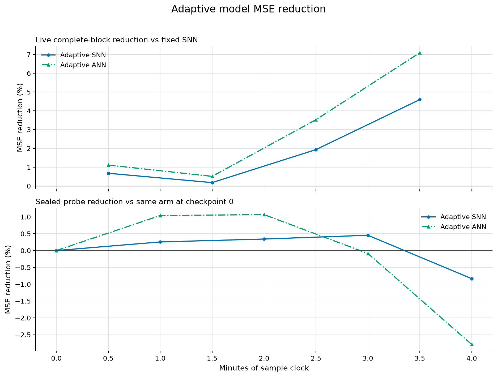

# First live microphone learning curve

The first run captured a physical Blue Yeti input on 2026-10-18. The
initial signal check found strongest FFT bins around 100–200 Hz, often
near 145 Hz, without clipping. Sound was present; fan attribution was
not independently established.

The live implementation is source `aa5057289f58720b6f76d7ff8fca6bf8bb15020c`.
The recipe SHA-256 is
`ef7019083c0fcb24f3477a8384a5b3deccd260fd1ad9f7ef1d133c433b065561`.
The fitted reference fingerprint is
`1c56faa17c45f6f3ba43d053637953e414f4ace0d0de42673b5abcaaca98385d`.
The fixed SNN's parameters and the fit-only normalization remain unchanged.

## Four complete monitoring minutes

After the initial 30-second fit, 30-second calibration and 20-second
sealed-probe collection, the first four complete monitoring blocks contain
1,175 scored frames: 235 seconds after the five-second warmup, or 7,050
band targets. These targets and repeated probe checkpoints are correlated.

| Predictor | Live MSE | Reduction vs fixed SNN | Observed alarms/minute |
|---|---:|---:|---:|
| Adaptive SNN | 0.012260589 | 1.924% | 0.511 |
| Fixed SNN | 0.012501089 | reference | 0.511 |
| Adaptive ANN | 0.012102101 | 3.192% | 0.511 |
| Five-second EMA | 0.012118929 | 3.057% | 0.511 |
| Persistence | 0.022247512 | -77.965% | 1.277 |

On the unchanged probe, the SNN initially improves, then loses that gain:

| Monitor checkpoint | SNN probe MSE reduction vs its start |
|---|---:|
| 0 minutes | 0.000% |
| 1 minute | 0.256% |
| 2 minutes | 0.342% |
| 3 minutes | 0.454% |
| 4 minutes | -0.835% |

The ANN's probe error is 2.790% higher than its own starting error at
minute four. Fixed-SNN, EMA and persistence probe errors repeat exactly.
Both adaptive models therefore show a live prediction gain and a loss on
the saved probe. Neither result establishes fault-detection accuracy.
The ANN and EMA outperform the adaptive SNN on these live blocks.

The SNN's learning is active: compared with monitoring start, 71 of 72
input weights, 71 input biases, 36 readout weights and six output biases
differ at minute four. The fixed model changes none of those parameters.
No signal-quality failure was reported in this prefix.

The [five-arm absolute errors](../artifacts/audio-live-session-20261018/minute-004/chart/audio-progress.png)
retain all controls. The [aggregate result](../artifacts/audio-live-session-20261018/minute-004/four-minute-result.json)
contains exact complete-block totals. Its companion status snapshot also
retains the later partial block, if present; the report and plots use only
the first four complete blocks and checkpoints 0–4.

## Verification and remaining scope

All 97 affected local tests pass in 3.245 seconds, including the audio
modules, a complete production-generated fixture-session arithmetic audit,
runtime lifecycle mocks and existing sensing regressions. The exact
compressed log and source receipt are under
`artifacts/audio-live-validation-20261018/`. No local full discovery was
run, and publication did not wait for remote CI. No tags were created.

The live runner independently checked trace arithmetic through monitor
frames 0, 300, 600 and 1,200 under the builder lock. The final prefix audit
covers 1,600 total frames and passed in about 0.14 seconds. It checks
normalization, forecast links, recorded errors, baseline recurrences,
alarms and totals; it does not independently replay the neural model.
Every plotted absolute error and percentage was compared with the saved
aggregate values, including both negative final probe changes.

The first-minute evidence remains preserved separately. Raw PCM is
discarded after extraction; feature/forecast traces and parameter arrays
stay private, outside Git. Aggregate publication omits device identity
and local paths. This run remains active with the original reference and
recipe; periodic checks will retain longer-run gains and losses.

Issue #86 remains open: independently labeled physical changes, separate
sessions, fault-detection acceptance and device-energy measurements are
still missing. These first four minutes do not establish sustained learning
or an SNN-specific sensing advantage, and do not alter the previous frozen
graph or vibration experiments.
