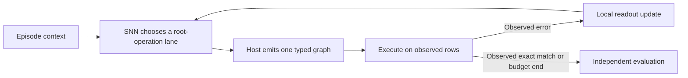

# Online learning from graph execution

The owner clarified the objective on 2026-10-18: an embedded SNN that
senses, retains experience and adapts from consequences, eventually on a
chip connected to a small host such as a Raspberry Pi. An LLM may assist
development, but must not supply the deployed learner's updates or choose
each program for it.

The first implementation is an additive software experiment. A persistent
policy chooses a root-operation lane; the host generates and executes that
lane's next typed graph. Only afterward does observed execution error
produce a learning signal. Deterministic execution and independent final
acceptance remain outside the learner.

The prototype uses a fixed 16-unit binary LIF encoder and a plastic
three-action softmax readout. A pending decision stores its score-function
eligibility until execution supplies a reward. The reward updates that
decision's readout connections and consumes the trace. Version 1 does not
assign later candidates' rewards to earlier actions. It implements neither
STDP nor multi-step delayed-return learning. The matching nonspiking control
uses continuous leaky activations with the same projection/readout shape.

Weights and a reward baseline persist across episodes. Membrane state and
credit traces reset at explicit episode boundaries. A second control
discards learning at every boundary, and a frozen control disables updates.
No candidate batch position serves as a persistent neuron or operand
identity. The historical independent-drive contract repaired in #52 stays
unchanged.

The controller sees previous action, previous observed error, within-task
progress and a bias. It does not see task content, target programs, future
tasks, phase labels or held answers. Consequently this pilot tests operator
prior adaptation, not task-conditioned program understanding. It has no
physical sensor input, chip export, integer hardware implementation or
measured device energy. Hardware selection must later establish support for
the required on-device weight updates, precision and memory.

Implementation and evidence are tracked in
[#83](https://github.com/Capsize-Games/rsi-programmer/issues/83).
The preregistered experiment and limitations are in
[benchmark-online-graph.md](benchmark-online-graph.md). Earlier frozen
ranking results remain valid for their own architecture. This new objective
does not convert those negative results into an SNN advantage.

## Assessment of the supplied paper

Hesse and colleagues' [bioRxiv v1 preprint](https://doi.org/10.64898/2026.10.15.759299),
*Rapid alternation of conscious and suppressed stimulus representations in
the primate brain*, reports macaque visual-cortex recordings during flash
suppression. The authors infer alternating stimulus representations using
fixed response templates and offline statistical models. They examine
circular-analysis bias with split-neuron inference/readout and other
controls. The manuscript is not peer reviewed; code and electrophysiology
data are promised upon publication.

Its useful connection here is methodological: inference inputs and
independent readout must be separated. It does not demonstrate an online
learning rule, code synthesis, an SNN implementation, or chip efficiency.
An engineered alternation between competing hypotheses would be a separate
experiment; this prototype does not implement it or claim consciousness.

The complete 50-page PDF, including Methods and Extended Data, was read
from the [primary PDF](https://www.biorxiv.org/content/10.64898/2026.10.15.759299v1.full.pdf).
Its SHA-256 is
`c3ee77548a713e024ea62e4ac58f18327c4e15fc10a8cfda121b345fb70591bf`.
The publisher PDF is retained locally outside the repository; no code or
data availability beyond the manuscript's statement was assumed.

## Diagnosis after the encoder-learning comparison

The current primary benchmark is poorly matched to the intended sensing
device. It tests allocation of a finite symbolic search budget among three
root-operation lanes. It supplies six static, labeled arithmetic examples,
not a timed sensor stream. It has no deployment energy or latency
measurement. This is sufficient reason to change the primary test; it is
not a causal explanation of every failed search result or evidence that a
different task will favor an SNN.

Keep the [code-v103 result](online-plastic-encoder-result.md) as a negative
result for this controller and task. Learning both incoming projections
added one acceptance out of 864 repeated attempts at the primary budget,
and none of the three principal gates passed in any phase order. The
nonspiking controls also struggle. Increasing neuron count, adding memory
or tuning on this corpus is not justified as the next product experiment.

Read-only diagnostics of the existing frozen corpus and retention records
identify two concrete constraints. The
[scripts and source proofs](../artifacts/online-sensing-diagnosis-20261018/README.md)
are retained for reproduction:

- Different task roots share identical cold SNN rate codes. At
  initialization, an arbitrary lookup table over those codes could label
  at most 32/48, 27/48 and 29/48 contexts correctly for seeds 0, 1 and 2.
  The code mixes task roots before the readout can act. This is a bound
  only on classification from those particular cold codes, not on later
  sequential search or on another learned encoder. The corresponding
  bound after learning averages 60.53%, compared with 61.11% initially.
  The continuous control has unique codes but still performs poorly;
  removing these collisions alone is not a demonstrated solution.
- For 9/48 tasks, a lane incapable of solving the target has a higher mean
  immediate reward over its full 144 candidates than the uniquely
  solvable lane. Reward for approximate candidate fit can therefore rank
  lanes differently from their ability to solve the task. These complete
  lane averages include candidates the actual early-stopping learner may
  never see. They demonstrate a possible incentive mismatch, not its
  causal contribution to the measured regression.

Every observed solution in the saved 13,824 episodes passed the independent
held and polynomial checks. The corpus explicitly separates its target
polynomials on the observed rows. Observed-only overfitting and ambiguous
root labels are not explanations supported by this corpus.

There are also architectural limitations relevant to sensing. The current
policy uses 16 independent membrane units, one decay constant, six repeated
steps per static input and a rate-averaged readout. It has no learned
connections between hidden neurons. Actual membrane state carries between
search choices, but derivative history truncates at each choice; both
membrane and pending credit reset at task boundaries. This implementation
does not test continuous temporal sensing or long-horizon credit. Neither
learned recurrence nor delayed credit is a prerequisite for every sensing
task; the necessary state depends on the signal and feedback timing.
Weight changes are real: the primary persistent plastic arm reports
91,002 encoder-update calls and changed encoder hashes on all 864 tasks.
Successful weight updates do not establish useful adaptation.

## Recommended next experiment

Move sensing into the main feedback loop. A first candidate is continuous
IMU or vibration prediction: make a prediction from past observations,
score it when the next actual measurement arrives, and update only after
that measurement. Choose the device behavior and feedback source before
freezing a new protocol. Passive sensing is a valid first task; active
measurement selection and delayed rewards are not mandatory.

Use the following design constraints:

1. Represent actual sample times or event times. Keep temporal state over
   the sensor's relevant time scales, with explicit session resets. Select
   time constants and any recurrence from the workload; do not assume that
   adding recurrent connections or training every parameter will help.
   Define this state contract in the sensing module; preserve independence
   of existing graph-scoring calls.
2. Separate fast sensory state from slower parameter adaptation. Start
   with feedback the device can genuinely observe, such as next-sample
   error or a measured calibration reference. Anomaly detection needs its
   own definition of normal behavior and independent evaluation labels;
   unexpected input is not automatically a fault.
3. Freeze recordings and held recording sessions, devices or environments
   before tuning. Predict before updating; preserve chronology and keep
   future samples out of preprocessing. Include repeatable changes and
   returns to earlier conditions to measure adaptation and forgetting.
4. Compare with a fixed SNN, a simple signal-processing or adaptive-filter
   baseline, and a small continuous model. Match available information,
   feedback and resource constraints. Retain a capacity-matched comparison
   for diagnosis and competitive baselines for the device decision.
5. Measure prediction or detection utility, adaptation time, retention,
   latency, RAM and total device energy separately. Include acquisition,
   encoding, host communication, updates and idle costs. Python simulation
   CPU and spike counts cannot establish physical energy savings.
6. Specify which chip can execute which updates, at what precision and
   memory cost. On-chip inference and on-chip learning are separate
   requirements. A Pi or other host may acquire data and supervise the
   device, but host-side learning must not be reported as on-chip learning.

Keep graph search as a secondary integration workload. Later it could
propose filter or calibration graphs outside the fast sensing loop, if
that becomes useful. Its independent execution/checking and reproducible
controls remain valuable; it should not decide whether the sensing device
is viable.

This recommendation follows the distinction between algorithm quality and
deployed system cost in the
[NeuroBench framework](https://www.nature.com/articles/s41467-025-56739-4).
The [Xylo audio study](https://arxiv.org/abs/2208.12991) provides a concrete
example of streaming sensory inference using several temporal scales;
its offline training and dynamic inference-power result do not establish
online adaptation or energy for our design. The
[e-prop study](https://www.nature.com/articles/s41467-020-17236-y) and
[Lava learning documentation](https://lava-nc.org/lava/notebooks/in_depth/three_factor_learning/tutorial01_Reward_Modulated_STDP.html)
show mechanisms for longer eligibility and hardware-constrained learning.
They provide candidate methods, not a verified mapping of our rule or a
reason to transplant a new architecture before defining the sensing task.
