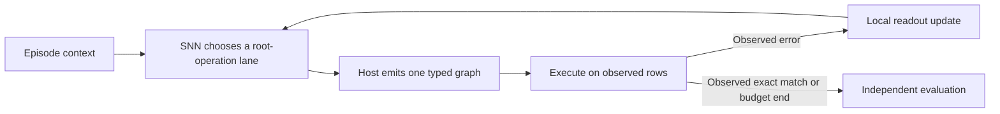

# Online learning from graph execution

The owner clarified the objective on 2026-10-18: an embedded SNN that
senses, retains experience and adapts from consequences, eventually on a
chip connected to a small host such as a Raspberry Pi. An LLM may assist
development, but must not supply the deployed learner's updates or choose
each program for it.

The first implementation is an additive software experiment. A persistent
policy chooses a root-operation lane; the host generates and executes that
lane's next typed graph. Only afterward does observed execution error
produce a learning signal. Deterministic execution and independent final
acceptance remain outside the learner.

The prototype uses a fixed 16-unit binary LIF encoder and a plastic
three-action softmax readout. A pending decision stores its score-function
eligibility until execution supplies a reward. The reward updates that
decision's readout connections and consumes the trace. Version 1 does not
assign later candidates' rewards to earlier actions. It implements neither
STDP nor multi-step delayed-return learning. The matching nonspiking control
uses continuous leaky activations with the same projection/readout shape.

Weights and a reward baseline persist across episodes. Membrane state and
credit traces reset at explicit episode boundaries. A second control
discards learning at every boundary, and a frozen control disables updates.
No candidate batch position serves as a persistent neuron or operand
identity. The historical independent-drive contract repaired in #52 stays
unchanged.

The controller sees previous action, previous observed error, within-task
progress and a bias. It does not see task content, target programs, future
tasks, phase labels or held answers. Consequently this pilot tests operator
prior adaptation, not task-conditioned program understanding. It has no
physical sensor input, chip export, integer hardware implementation or
measured device energy. Hardware selection must later establish support for
the required on-device weight updates, precision and memory.

Implementation and evidence are tracked in
[#83](https://github.com/Capsize-Games/rsi-programmer/issues/83).
The preregistered experiment and limitations are in
[benchmark-online-graph.md](benchmark-online-graph.md). Earlier frozen
ranking results remain valid for their own architecture. This new objective
does not convert those negative results into an SNN advantage.

## Assessment of the supplied paper

Hesse and colleagues' [bioRxiv v1 preprint](https://doi.org/10.64898/2026.10.15.759299),
*Rapid alternation of conscious and suppressed stimulus representations in
the primate brain*, reports macaque visual-cortex recordings during flash
suppression. The authors infer alternating stimulus representations using
fixed response templates and offline statistical models. They examine
circular-analysis bias with split-neuron inference/readout and other
controls. The manuscript is not peer reviewed; code and electrophysiology
data are promised upon publication.

Its useful connection here is methodological: inference inputs and
independent readout must be separated. It does not demonstrate an online
learning rule, code synthesis, an SNN implementation, or chip efficiency.
An engineered alternation between competing hypotheses would be a separate
experiment; this prototype does not implement it or claim consciousness.

The complete 50-page PDF, including Methods and Extended Data, was read
from the [primary PDF](https://www.biorxiv.org/content/10.64898/2026.10.15.759299v1.full.pdf).
Its SHA-256 is
`c3ee77548a713e024ea62e4ac58f18327c4e15fc10a8cfda121b345fb70591bf`.
The publisher PDF is retained locally outside the repository; no code or
data availability beyond the manuscript's statement was assumed.
