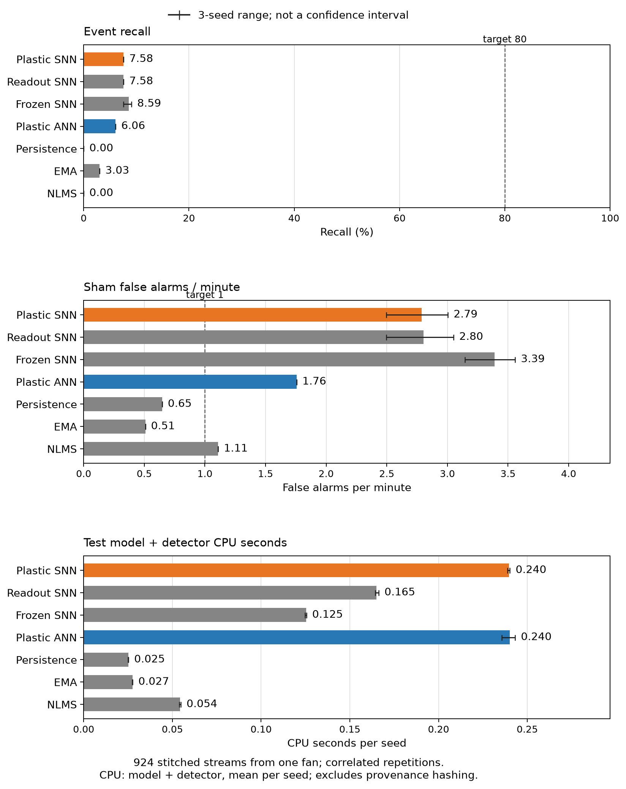

# First vibration change-detection result

The first timed sensing pilot failed its reliability, adaptation,
SNN-specific and competitive gates in all three seeds. Online learning
improved forecasting relative to freezing the same trained SNN, but that
did not produce a useful change detector. No device or chip gain is shown.

This completes the bounded recorded-data experiment in
[#85](https://github.com/Capsize-Games/rsi-programmer/issues/85).
The next physical-sensor experiment is tracked in
[#86](https://github.com/Capsize-Games/rsi-programmer/issues/86).

## Scope and source

The [protocol](benchmark-sensing-fan.md) was published as code-v105 before
model execution or held measurement. Its SHA-256 is
`b604d5cb2a88f9dcc7278c0f3ffd6e7437ccf798956958283235e8663a31d191`.
The unmodified CC BY 4.0
[UCI fan recordings](https://archive.ics.uci.edu/dataset/846/accelerometer)
and their attribution are retained in
[`data/sensing_fan_v1`](../data/sensing_fan_v1/SOURCE.txt).

The implementation is `643be256363f2f23f9c51f280fb38d262a6f992d`.
The verified code-v106 checkpoint,
`de8798324cba7f5170a65f8f341f2ecc2ad52cd4`, has identical measured
runtime/test/workflow inputs and was the benchmark source. The evidence
manifest pins all 218 measured source inputs and both dataset hashes.

The run contains seven arms, three neural initialization seeds, eleven
held operating speeds and two change/two sham streams at each speed:
924 stream rows and 277,200 feature windows. Each arm has 198 repeated
event evaluations pooled across seeds, from 66 joins per seed. These
reuse recordings from one fan; they are correlated evaluations, not 198
independent physical events. Times are nominally inferred at 50 Hz.
Configuration joins are synthetic, and configurations are not fault labels.

## Gains and losses

| Arm | Detected / repeated events | Recall | Sham alarms/min | Prediction MSE | Test CPU/seed (s) |
|---|---:|---:|---:|---:|---:|
| Plastic SNN | 15/198 | 7.58% | 2.789 | 0.070092 | 0.240 |
| Readout-only SNN | 15/198 | 7.58% | 2.804 | 0.070145 | 0.165 |
| Frozen trained SNN | 17/198 | 8.59% | 3.390 | 0.084255 | 0.125 |
| Plastic continuous model | 12/198 | 6.06% | 1.757 | 0.064059 | 0.240 |
| Persistence | 0/198 | 0.00% | 0.647 | 0.051500 | 0.025 |
| EMA | 6/198 | 3.03% | 0.508 | 0.029432 | 0.027 |
| Normalized LMS | 0/198 | 0.00% | 1.109 | 0.040580 | 0.054 |

CPU is the observed test model/detector processing, divided by three
seeds. It excludes preprocessing, copying, provenance hashing and output.
It is not end-to-end device latency, power or an on-chip estimate.
MSE uses normalized features. The median delay among the few matched
detections is 0.6 seconds for all arms with detections; missed events are
excluded from that conditional delay and dominate the result.

Online plastic SNN lowers MSE by **16.81%** versus freezing its identical
trained parameters. Sham alarms also fall from 3.390 to 2.789/minute, but
recall falls from 8.59% to 7.58%. This is a forecasting improvement, not
evidence of useful change detection or persistent retention.

Learning the encoder adds only **0.076%** MSE improvement over learning
the readout alone. Both detect exactly 5/66 events in each seed. One fewer
sham alarm appears across the three-seed aggregate, while test processing
CPU rises **45.24%**. Incoming weights did update: 876,809 stored input/bias
changes are recorded over 39,468 test update calls. The tiny contribution
cannot be explained by updates being silently disabled.

The SNN has 1.52 percentage points higher recall than the continuous
control but 1.03 more sham alarms/minute and higher MSE. EMA has the lowest
MSE; the SNN's MSE is 2.38 times EMA's and its model/detector CPU is 8.72
times EMA's in this software run. EMA also misses almost every event.
None of these arms establishes a usable detector at this operating point.



The practical target was at least 80% recall and at most one sham alarm
per minute in every seed. Plastic SNN achieves 7.58% recall in each seed
and 2.50-3.00 sham alarms/minute. Every frozen gate passes in **0/3 seeds**.
Persistence and EMA meet the false-alarm cap but miss most changes, so the
competitive comparison is not vacuous. SNN detections occur only at speeds
70, 75 and 90; at 70/75, sham alarm rates are also high. The complete
speed/order/seed results remain in the raw and summarized evidence.

## Interpretation and next test

The experiment rejects a performance claim for this particular causal
predictor/alarm recipe. It cannot identify a unique cause. Single-axis RMS
discards waveform detail and other axes. Held speeds, changed arrangements
and synthetic joins differ from the training/calibration prefixes. A
one-step prediction loss is not a detector objective, and improved MSE
does not guarantee better event recall. These are hypotheses about limits,
not measured causal explanations or a general verdict against SNNs.

There is also a calibration-design concern: at five feature windows per
second, a 99.5th-percentile threshold corresponds to about 1.5 raw
exceedances/minute in an ideal continuous IID distribution. Under the same
idealized independent Bernoulli model, five-window cooldown gives
`300*0.005/(1+4*0.005) = 1.47` alarms/minute. Both exceed the declared
1/minute cap. This is not an estimate for these correlated recordings or
proof of why the models failed. The original operating point and failed
gates remain unchanged; future calibration should target the actual
sequence-level alarm budget using calibration data alone.

The next prospective experiment should establish a real timestamped
sensor/ground-truth contract and a clearly detectable physical change with
shams. First check a fixed signal-processing positive control. Freeze new
sessions and a small input/plasticity comparison before measuring held
outcomes: current RMS versus a richer causal input, each online versus
frozen, with cheap and continuous controls retained. That separates input
and learning contributions. Recognition and adaptive control remain later
stages. Hardware precision, memory, learning placement, latency and power
remain unmeasured; #86 tracks them. Graph search stays secondary and its
previous negative conclusions are unchanged.

## Verification and reproduction

All model/test/benchmark/audit execution was serial under
`/tmp/rsi-programmer-builder.lock`. The frozen comparison ran once, without
held-result tuning. Independent replay verified forecasts, exact parameter
and boundary hashes, training/calibration isolation, normalization, source
slices, thresholds, alarms, work counts, metrics and gates for the complete
924-row matrix. Eight corruptions were rejected after rebinding altered
file hashes, so rejection required semantic checks rather than just a
checksum mismatch. The original evidence bundle was not altered.

| Check | Result |
|---|---|
| Affected sensing tests | 56 passed in 2.546 s; no exclusions |
| Required `just test-fast` | 521 passed in 235.269 s; no exclusions |
| CI fast Python 3.12 | 521 passed in 385.627 s |
| CI fast Python 3.13 | 521 passed in 466.981 s |
| Frozen comparison | 924 rows, 277,200 windows; wrapper wall 17.807 s |
| Independent complete replay | Passed; wrapper wall 10.126 s |
| Corruption controls | 8/8 rejected; wrapper wall 73.505 s |

The runner reports 16.933 seconds CPU and 16.934 seconds wall in its timed
region, including 0.332 seconds data preparation. That region starts after
initial source capture and ends before final manifest output; it excludes
interpreter startup. Test model/detector CPU totals 2.632 seconds across
all arms; provenance, training/calibration, evaluation, copying and file
output account for other work. The enclosing wrapper covers the full CLI
wall interval. No measurement establishes complete device cost.

Earlier failed attempts are retained: a stale import, a missing history
advance in the independent NLMS reference, and integer-versus-float
canonical snapshot metadata. Additional integration checks cover the
repaired non-mutating training-hash validation, baseline cloning and
deterministic sequence fields with separate measured timing fields.
No assertion or precision threshold was weakened to pass the checks.

Remote [CI run 39175002963](https://github.com/Capsize-Games/rsi-programmer/actions/runs/39175002963)
belongs to implementation source `643be25`; its full matrix remains
pending in the retained snapshot. Both fast jobs passed; exact source-bound
logs and test counts are retained. Evidence-only checkpoints have identical
runtime/test/workflow inputs. No local slow/retry/full discovery was run
for this additive sensing path, and the paused CI heartbeat was not
resumed. Real hub integration and all previous tests remain intact.

Evidence directories:

- [`sensing-fan-v1-20261018`](../artifacts/sensing-fan-v1-20261018):
  raw training, calibration, compressed streams, summary and manifest.
- [`sensing-fan-validation-20261018`](../artifacts/sensing-fan-validation-20261018):
  source-bound test receipts, exact compressed logs, independent audit,
  corruption checks and descriptive contrasts.
- [`sensing-fan-plots-20261018`](../artifacts/sensing-fan-plots-20261018):
  PNG/SVG and exact plotted values/source hashes. Whiskers show seed ranges,
  not confidence intervals. Learned parameter arrays are not published.

Read-only replay of the retained bundle, at its source revision:

```sh
flock /tmp/rsi-programmer-builder.lock .venv/bin/python \
  -m scripts.audit_sensing --bundle artifacts/sensing-fan-v1-20261018
```

The current sensing flow and exact local learning rule are in
[`architecture.md`, section 12](../architecture.md#12-additive-timed-sensing-predictor).
