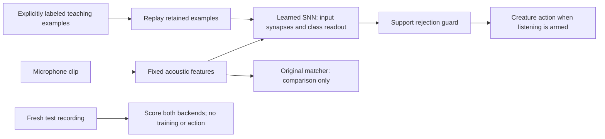

# Sound Companion

A native Linux desktop creature that learns short sounds from microphone
examples with a spiking neural network. Each taught sound can wake it,
put it to sleep, make it dance, or start a one-minute timer. The SNN chooses
the action label. The original example matcher remains a comparison control.

Run from the repository root:

```bash
just sound
```

`just install-sound` adds **Sound Companion** to your application menu.
The shortcut uses this checkout and its desktop environment; it does not
start the app at login.

## Teach and test

1. Click **Enable microphone** and stay quiet during the brief background
   calibration. Capture uses the current physical microphone input.
2. Enter a sound name, choose an action, and click **Record example**.
   Wait for **Make sound now**, then make a short, distinct sound.
   Record three examples for that name. Try a whistle, a clap, or a pair
   of taps; deliberately similar sounds may be rejected as ambiguous.
3. Select that name under **Test recognition**, click **Record test sound**,
   and make a fresh example after the cue. The window shows the expected
   and recognized names and counts correct tests for the SNN and matcher
   on the same recording. Test recordings do not
   add training examples, fire actions, or become correction candidates.
4. Click **Start listening** to enable the assigned actions. For a live
   recognition mistake, select its correct name in **Sound memory** and
   click **Correct last sound**. This explicitly adds the recent live
   example to the selected name; it does not repeat the mistaken action.
5. Teach another name, then test the older names again. Close and reopen
   the window and repeat the checks to verify that saved memory reloads.

Teaching, correction and forgetting fit the SNN in a background worker.
The window and timer keep responding; another training operation is blocked
until it finishes. Closing waits for the current save to finish. The model
fingerprint and cumulative update count are shown below the paired probe
counts. The window needs at least 800 pixels of height for these controls.

**Pause listening** pauses recognition actions while keeping the microphone
available for teaching and tests. Close the window to release the microphone.
No distinct onset within five seconds cancels a recording. Keep sounds
within roughly one second after the cue, and use approximately the same
microphone position and background conditions while teaching and testing.

The microphone must hear an onset at least 5 dB above its calibrated
background. If it reports no distinct sound, try a sharper sound or move
closer. The input level is measured amplitude, not recognition confidence.
The timer counts down for 60 seconds and rings the desktop bell at zero.
The other actions animate this application; there are no arbitrary shell
commands or external app controls in this version.

## Memory

By default, taught feature examples, trained SNN parameters and paired test
summaries are saved to
`~/.local/state/rsi-programmer/sound-companion/memory-snn-v1.json` with
owner-only file permissions. Raw audio is held briefly in memory and is
not saved. Existing `memory.json` examples are imported and used to train
the SNN once; that original file is preserved. Reopening the app then loads
the saved SNN parameters without retraining.
**Forget sound** deletes only the selected name. Adding a new name retains
older examples; recognition can still become ambiguous when names sound
alike. A corrupt saved file is preserved and further writes are blocked.

The fixed acoustic features describe 1.2-second clips as 12 time bins of
20 values. A trainable input layer drives 64 leaky integrate-and-fire
neurons. Binary spikes feed the learned class readout. Explicit teaching
trains both layers with surrogate gradients and replays all retained
teaching examples, including older sounds. This is supervised learning
from names you provide, not autonomous learning from unlabeled background.

A separate feature-distance guard can reject an unsupported or ambiguous
SNN choice. It uses the same support rules as the original matcher, with
alignment limited to one 100 ms time bin. It never substitutes the matcher's
label or triggers a fallback action. The app retains at most 20 examples
per name. Neither readout scores nor example distances are calibrated
probabilities. Fresh recordings in the test panel check your own sounds;
generated checks do not establish microphone accuracy or chip efficiency.



## Setup and checks

The desktop environment uses the system Python's Tk library. The existing
research `.venv` is unchanged. Its bundled Tk aborts when constructing even
a text-entry widget on this machine, matching the upstream
[standalone-Python Tk issue](
https://github.com/astral-sh/python-build-standalone/issues/146).

```bash
just setup-sound /absolute/path/to/spikeforge
just test-sound
```

Setup requires system Python with Tk, `uv`, a local Spikeforge checkout,
and PulseAudio/PipeWire's `pactl` and `parec`. `test-sound` uses Xvfb for
isolated native-window checks. The pinned runtime requirements are the
same as the research environment. No model weights or sound memory belong
in Git.

The original matcher's small development check runs with:

```bash
flock /tmp/rsi-programmer-builder.lock \
  .venv-desktop/bin/python -m scripts.check_sound_learning_demo
```

It creates a temporary memory, teaches three generated sound families,
tests fresh seeded variations, adds a fourth, rechecks the old sounds,
reloads memory, and checks all four. It reports failed and unknown matches
alongside successes. These generated clips are not recordings of a user.

The frozen SNN-versus-matcher comparison runs with:

```bash
flock /tmp/rsi-programmer-builder.lock \
  env OMP_NUM_THREADS=1 MKL_NUM_THREADS=1 \
  .venv-desktop/bin/python -m scripts.compare_sound_backends \
  --output-dir artifacts/NEW-sound-comparison
```

Its protocol is `fixtures/sound_comparison_v1.json`. Three SNN parameter
seeds receive identical taught examples and identical fresh generated
queries. Reports include raw neural choices, guarded action decisions,
matcher outcomes, unknown controls, retention after adding a class, reload
equality and work timings. This comparison is a software test, not evidence
that spikes improve accuracy or energy use.
