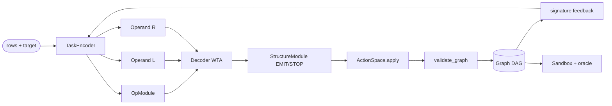
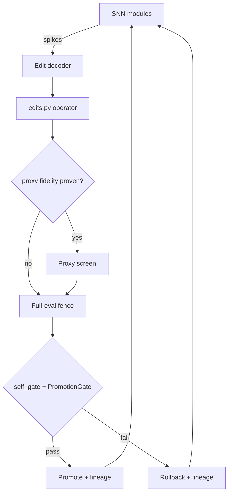
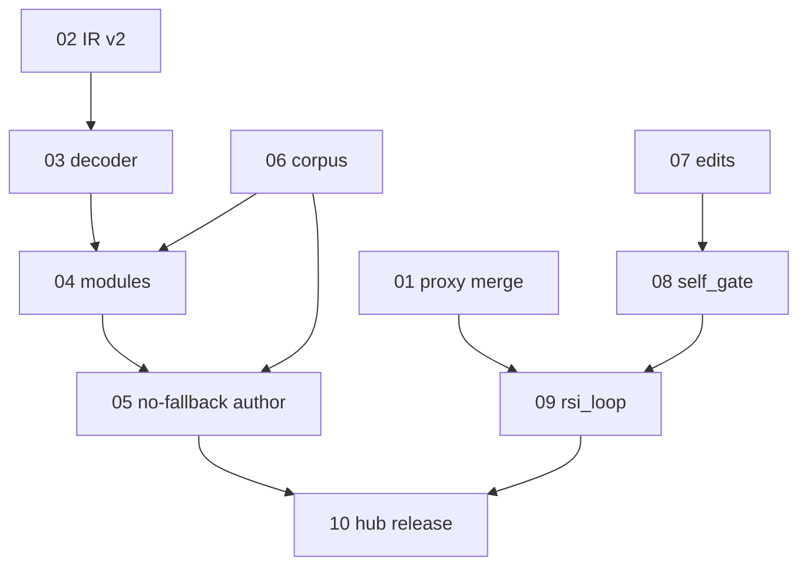

# SNN Programming Plan — Signal Modules That Emit Graph Calls

> Status: proposal only. No code in this document is implemented yet.
> Source of truth for the current system is the code cited below, read
> 2026-10-15 from `main` (`a567fe0`). Metrics marked "last measured" come
> from the frozen session's training report (commit `85bf064`,
> weights-v2/v3) and were not re-measured for this plan.

## Verdict (read this first)

- **The SNN has not edited its own code. No.** It ranks pre-enumerated
  `(op, left, right)` triples. Every trainer change to date was designed
  by an agent, not proposed by the weights.
- **What exists is search guidance, not programming.** `author.py` can
  commit graph edits (`emit_edit` → `ActionSpace.apply`), but acceptance
  still falls back to `guided_search` enumeration when authoring fails.
  Programming starts when the fallback is removed and the SNN's signals
  alone build a validated graph.
- **Direction is sound; scale is not.** Keep "code = typed graph calls
  decoded from spikes." Fix the bottlenecks: 3-op Int-only language,
  monolith scorer, final-layer-only training signal, 11-task corpus,
  unmerged proxy, missing edit/gate/loop modules.

## 1. Where we are

The codebase is a staged attempt to make SNN signals produce code.
"Code" was never text: it is a pure, typed computation DAG, executed
only by an allowlisted interpreter, judged by an independent oracle.

| Stage | Module(s) | What the signals do today |
|---|---|---|
| W1 traces | `traces.py`, `probe.py` | Enumerator runs; every search state → choice pair is frozen. Splits hashed (`split_hash`); `oracle_holds` checks train + held-out. |
| W2 ranker | `policy.py` | One SNN (`DIM=12`, `HIDDEN=16`, `STEPS=6`, fc→leaky(β=0.9)→readout) scores triples; mean readout over 6 constant-drive steps. Adam pairwise-margin on final layer only. |
| W2 evolve | `evolve.py`, `pool.py`, `lineage.py` | `POP=4`, `SIGMA=0.1`; gradient/perturb children; Pareto (correctness, efficiency, recovery); every entry persisted via `record_intent`. |
| Author (#37–39) | `author.py`, `actions.py`, `rich.py` | Greedy/beam author commits edits with early-layer subtree labels; operand contrastive groups + joint margin/listwise (λ=0.2, 5 epochs). Fallback to enumeration still on. |
| W3 gate | `promote.py` | `PromotionGate.decide`: zero safety failures + bootstrap lower bound > 0 + mean gain ≥ 0.05 + budgets. `curriculum()` clusters failures. |
| #35 scale | `scale.py`, `rich.py` | 4 rich features, surrogate caps (`NEG_CAP=1500`, `SEL_CAP=750`), budgets `CPU_BUDGET_S=480`, `EVOLVE_BUDGET_S=240`, `GENERATIONS=3`. Biases recorded, never hidden. |
| W4 headless | `headless.py`, `sandbox.py` | "SNN proposes, sandbox disposes." Disposable subprocess (5s wall / 5s CPU, max 64 nodes); verdict recomputed supervisor-side; JSONL trace; gate decides. |

Last measured (do not quote as current without re-running): operand
top-1 0.200/0.067/0.133 → 0.267/0.133/0.200 (chance 0.060); beam wins
10/24 → 11/24, zero flips; transfer 3/3 on the 3 novel tasks. Corpus:
4 shadow + 4 hard + 3 novel = **11 tasks total**. Weights `w1`/`w2`
tracked in `weights/`; `weights-v3` released from `85bf064`.

Freeze lesson (resource rule for all work below): at 11:41 three
isolated builders stacked on live training peaked at **11.6GB RSS,
30 processes, 3 exec sessions** and locked a 31GB/16-core box.
**Sequential only: one builder, no isolated worktrees, no background
training during builds, narrow test files, no Workflow fan-out.**

## 2. What "programming with the SNN" means here

Programming = **SNN modules transmit spike signals; a fixed decoder
turns those signals into typed graph calls; the interpreter runs the
graph; the oracle judges held-out behaviour.** The surface form of
"code" is irrelevant by design:

- Binary spike trains are the *signal*.
- Math (signatures, gaps) is *feedback* to the modules.
- Graph calls (`{"op": "add", "type": "Int", "args": [...]}`) are the
  *program*.
- Rendered Python (`probe.render_source`) is a report artifact only —
  never executed. Do not let any issue below turn this into a text
  generator.

Why this is the best direction: the graph is small, typed, acyclic,
and fully checkable before execution (`validate_graph` rejects unknown
ops, cycles, forward refs, wrong arity). The SNN never needs to emit
syntax; it needs to emit *decisions* (which op, which operands, emit
or stop). That is exactly what spikes are good at, and it keeps the
engine — not the learner — deciding success.

## 3. Target architecture

### 3.1 Keep the IR; grow it in typed steps

`probe.py` today: `OPS = {add, sub, mul}`, `input_types = {x: Int,
y: Int}`, `MAX_TREE_OPS = 4`. That ceiling makes "programming"
unprovable beyond tiny polynomials. Grow the IR one typed feature at a
time, each with validator + interpreter + negative controls in the
same change: (a) integer constants, (b) `Bool` + `select` (branch),
(c) bounded `repeat` with static count cap, (d) only then wider ops.
Every new node kind must keep `validate_graph` decidable and
`sandbox` caps meaningful. Task fixtures stay frozen with
`split_sha256`; new families are new files, never edits to held-out rows.

### 3.2 Replace the monolith with transmitting modules

Current `SearchPolicy` is one 12→16→LIF→1 scorer: one scalar per
triple, so cost explodes as `|ops| × |refs|²` and no signal ever
"means" an operand. Factor it into `TopologySpec` stages connected by
`Edge`s, each with a population readout:

- **TaskEncoder** — turns (rows, target, built signatures) into a spike
  drive. Replace scalar hit/inside fractions with a population over
  signature positions so *which* rows match is transmitted, not just
  how many.
- **OpModule** — population over `OPS`; winner-take-all decides the op.
- **OperandModules (L/R)** — pointer populations over available refs
  (inputs + built nodes). Cost becomes `|ops| + 2|refs|`.
- **StructureModule** — EMIT / STOP / CONTINUE + depth budget. Today
  the outer `for size in 1..bound` loop decides structure; the module
  must emit that decision as a signal.
- **Feedback edge** — signature of the proposed node re-enters
  TaskEncoder (open-gap as spikes), so modules *converse* across
  steps instead of scoring a static batch.

Temporal code inside the existing `STEPS=6` window: phase 0 operand
proposal, phase 1 op vote, phase 2 structure gate; first-spike latency
= confidence. Keep `build_module`/`snapshot`/`restore` contracts; the
change is topology + readouts, not a new framework.

### 3.3 Decoder: spikes → graph calls

Fixed, non-learned, tiny: per population, WTA + threshold → one
`ActionSpace` action (`input` or `apply`). Ties or sub-threshold =
reject with logged verdict (reuse `emit_edit` records). The decoder
alphabet *is* the safety boundary: if a token is not in the alphabet,
the SNN cannot emit it. `ActionSpace.typecheck` still calls
`validate_graph` on every extension; `SandboxRunner` still recomputes
every verdict supervisor-side and ignores claims.

### 3.4 Training signal

- Keep surrogate-gradient Adam; move labels from final-layer-only
  (`policy._label_final`) to all-layer subtree labels already in
  `author._base_groups` (`solution_sigs`).
- Keep operand contrastive groups (`contrastive_groups`) and
  `refine_operands`; give each module a local loss (op accuracy,
  operand top-1, structure precision) plus the joint margin/listwise
  term. Report per-module metrics; a single scalar hides failure.
- Keep evolution (`PolicyLoop`/`ScaleUp`) as outer loop with Pareto
  fitness; never collapse correctness/efficiency/recovery (+hard
  benefit) into one number.

### 3.5 Self-edit: same decoder, different graph

The SNN "editing its own code" = the same modules emitting signals
that decode to **trainer-graph edits**: `TopologySpec` params (hidden,
beta, steps), loss weights (margin, λ), hyperparams, budgets. The
edit alphabet (`edits.py`, not yet built) must *structurally exclude*
`promote.py`, `sandbox.py`, `lineage.py` semantics, with a test
asserting no operator can name them. Pipeline per edit: propose →
proxy-screen (few-epoch/few-seed, only if measured fidelity clears
threshold) → fenced temp-copy trial with full-eval confirm
(`self_gate.py`, never proxy-only) → promote or rollback, lineage
record every outcome (`record_intent` + `SandboxRunner.lineage_hash`).
Unmerged `rsi/proxy` is the starting point; `edits`/`gate`/`loop`
must be rebuilt sequentially (their builders died uncommitted).

### 3.6 Safety invariants (non-negotiable in every issue)

1. Oracle is post-hoc only (`guided_search(..., oracle=)` vetoes,
   never guides; `ScaleUp._oracle` docstring is the rule).
2. Emitted source is never executed (`probe.py` header).
3. Sandbox verdicts are recomputed supervisor-side; `claim_ignored`
   stays true.
4. Promotion needs `PromotionGate` (bootstrap lower > 0, gain ≥ 0.05,
   zero safety failures) — learner scores alone prove nothing.
5. Budgets stop, not fail (`HeadlessLoop` `stopped-not-failed`);
   fidelity caps/biases are recorded in every report (`scale._consts`).

## 4. Graphs

### 4.1 Current pipeline (search guidance)


### 4.2 Target: signal modules emit graph calls



### 4.3 Self-edit loop (same decoder, trainer graph)



### 4.4 Issue dependency order (file in this order)



## 5. How to file these (for the low-cost worker)

File Issues 01–10 below **verbatim** (title, labels, body) in
dependency order. Do not implement anything in the filing turn. Link
each new issue to its dependencies with "Depends on #N" once numbers
exist. Milestone: `signal-programming`. Labels use the repo defaults
plus `snn`, `rsi`, `fidelity` where shown — create labels if missing,
do not invent new ones. After filing, reply with the 10 URLs in order
and stop. Resource rule: file sequentially; no parallel workers.

---

## 6. GitHub issues (copy verbatim)

### Issue 01 — Merge `rsi/proxy` and prove proxy fidelity before it judges anything

**Title:** Merge rsi/proxy and gate proxy use on measured fidelity
**Labels:** `snn`, `rsi`, `fidelity`

**Background.** A few-epoch/few-seed proxy (`rsi_programmer/proxy.py`,
`tests/test_proxy.py`) exists only on branch `rsi/proxy`
(`0cf70eb`, pushed to `origin/rsi/proxy`); `main` has no `proxy.py`.
The proxy screens self-edit candidates on a W1 subset and must report
its own rank agreement vs full transfer eval. An unproven proxy that
"judges nothing until proven" is the design; until fidelity is
measured on `main`, no loop may use it to discard candidates.

**Scope (in).** Merge `origin/rsi/proxy` into `main` sequentially in
the main checkout (no worktree fan-out). Add a fidelity report command
that replays ≥6 historical candidates (existing weights lineages) and
prints pairwise rank agreement, pairs count, epochs/seeds/subset used,
and wall saving vs full eval. Add a hard gate: proxy selection APIs
return "unproven" (no winner) unless agreement ≥ threshold on ≥3
pairs (branch constants `AGREE_THRESHOLD=0.8`, `MIN_PAIRS=3` — keep or
justify any change in the PR).

**Scope (out).** No `edits.py`, no `self_gate.py`, no loop wiring, no
IR changes, no new training runs beyond the fidelity replay.

**Acceptance criteria.**
- [ ] `rsi_programmer/proxy.py` and `tests/test_proxy.py` exist on
  `main`; 79-col lines, full type hints, one class per file.
- [ ] Fidelity report runs and prints agreement + pairs + subset;
  report is attached to the PR verbatim.
- [ ] Test proves: below-threshold or too-few-pairs → no winner named.
- [ ] Test proves: proxy never imports held-out/oracle expectations.
- [ ] Full suite green (command below); no baseline solve-rate drop.

**Validation.**
```bash
python -m unittest tests.test_proxy -v
python -m unittest discover -s tests -t .
```

**Depends on:** none. **Blocks:** Issue 09.

---

### Issue 02 — Probe IR v2: typed constants and branching (one feature per PR)

**Title:** Extend probe IR with constants and Bool/select, fully validated
**Labels:** `snn`, `rsi`

**Background.** `rsi_programmer/probe.py` is Int-only:
`OPS={add,sub,mul}`, inputs `x/y`, `MAX_TREE_OPS=4`,
`validate_graph` requires nodes `{op,type,args}` with exactly 2 Int
args and only backward refs. At this size "programming" cannot be
distinguished from curve-fitting tiny polynomials. The IR must grow
while staying decidable and sandbox-safe.

**Scope (in).** Two sequential PRs under this issue: (PR-A) integer
constant nodes with bounded range; (PR-B) `Bool` type with
comparisons (`lt`, `eq`) and `select(cond, a, b)` returning Int.
Each PR updates together: `OPS`/types, `Expr`/`signature`,
`validate_graph`, `interpret`, `lower_to_dag`, `render_source`
(report only), `ActionSpace` if the node shape changes, negative
controls (unknown op, cycle, forward ref, type mismatch, arity,
out-of-range constant), and fixture(s) with frozen `split_sha256`.
Keep old fixtures passing unchanged (backward compatibility).

**Scope (out).** No loops/repeat, no floats, no strings, no I/O, no
executed emitted source, no SNN topology changes (Issue 04).

**Acceptance criteria.**
- [ ] Old 11 tasks still solve with same verdicts; new feature tasks
  solve only via the new nodes (ablation: disable feature → fail).
- [ ] Every malformed graph in negative controls raises `ValueError`.
- [ ] `interpret` results match fixture oracle on train + held-out.
- [ ] `tests/test_typed_dag_programming_probe.py` extended per PR.

**Validation.**
```bash
python -m unittest tests.test_typed_dag_programming_probe -v
python -m unittest discover -s tests -t .
```

**Depends on:** none. **Blocks:** Issues 03, 06.

---

### Issue 03 — Spike-to-edit decoder with reject-on-tie semantics

**Title:** Add fixed spike decoder emitting ActionSpace edits
**Labels:** `snn`, `rsi`

**Background.** Today `SearchPolicy.scores` returns one float per
triple and `rank` sorts them; there is no mapping from spike
*populations* to a single emitted edit, so the SNN cannot "say" a
program step. `author.emit_edit` + `ActionSpace.apply` already
provide typed commit + logged verdicts; the missing piece is a
deterministic decoder in front of them.

**Scope (in).** New module `rsi_programmer/decoder.py` (one class,
full hints): input = per-population spike counts/latencies over the
existing `STEPS` window (op population, left/right pointer
populations, structure bits); output = one action dict accepted by
`ActionSpace.typecheck` (`input` or `apply`) or a structured reject
(`tie`, `sub-threshold`, `unknown-token`). Winner-take-all with
explicit thresholds as constructor params; ties reject, never guess.
Wire decoder → `emit_edit` in a test-only path; do not change
`author_search` behaviour yet (Issue 05 does).

**Scope (out).** No new SNN topology (Issue 04 feeds this decoder),
no learning inside the decoder, no text emission.

**Acceptance criteria.**
- [ ] Round-trip test: hand-built spike patterns decode to the exact
  expected actions for every op and both inputs.
- [ ] Tie/sub-threshold tests assert reject records with reasons.
- [ ] Decoded actions always pass `ActionSpace.typecheck` or reject
  before `apply` (property test over random spike inputs).
- [ ] Decoder cannot emit tokens outside `OPS` ∪ inputs (test).

**Validation.**
```bash
python -m unittest tests.test_rsi_decoder -v
python -m unittest discover -s tests -t .
```

**Depends on:** Issue 02 (alphabet must be final first). **Blocks:** 04.

---

### Issue 04 — Factor monolith into transmitting modules (encoder/op/operand/structure)

**Title:** Factor SearchPolicy into signal modules with per-module losses
**Labels:** `snn`, `rsi`

**Background.** `SearchPolicy._spec_for` builds one topology
(in→fc(12→16)→leaky(β=0.9)→out(16→1)); `_forward` averages the
readout over `STEPS=6` constant drives. One scalar per triple means
no module transmits an operand, cost is `|ops|×|refs|²`, and
`fit` trains only final-layer groups (`_label_final`). `author.py`
already proves richer supervision exists: `solution_sigs` subtree
labels, `contrastive_groups`, `refine_operands`.

**Scope (in).** New `TopologySpec` with stages: TaskEncoder
(signature-population drive replacing scalar hit fractions), OpModule
(population over `OPS`), OperandL/R pointer populations over refs,
StructureModule (EMIT/STOP/CONTINUE). Edges: encoder→all heads,
op→operand gating, proposed-node signature feedback→encoder.
Temporal phases within the step window (proposal/vote/gate). Keep
`build_module`, `snapshot`/`restore`, `perturb`, `weights` APIs;
old `scores`/`rank` stay as compatibility wrappers until Issue 05
cuts over. Train with all-layer groups + contrastive operand groups;
add per-module losses (op acc, operand top-1, structure precision)
alongside joint margin/listwise. Report per-module metrics in the PR.

**Scope (out).** No decoder changes beyond consuming Issue 03, no
fallback removal (Issue 05), no self-edit, no accuracy claims beyond
measured numbers with seeds and budgets stated.

**Acceptance criteria.**
- [ ] Snapshot/restore round-trips new spec + temporal state.
- [ ] Per-module metrics printed for a seed-0 run; operand top-1 and
  op accuracy reported vs chance with group counts.
- [ ] `guided_search` via wrapper solves same tasks as before (no
  regression on shadow family); cost `tried` reported per task.
- [ ] Tests: each head's output shape/alphabet; feedback edge changes
  step-2 decisions on a crafted task (proves transmission, not batch).

**Validation.**
```bash
python -m unittest tests.test_rsi_operands tests.test_rsi_actions -v
python -m unittest discover -s tests -t .
```

**Depends on:** Issues 02, 03. **Blocks:** 05. Run sequentially; do
not co-run with training loops (freeze lesson in plan §1).

---

### Issue 05 — Author without fallback: programming acceptance

**Title:** Remove enumerator fallback from acceptance; add path metric
**Labels:** `snn`, `rsi`, `fidelity`

**Background.** `author_search(fallback=True)` calls `_use_fallback`
→ `guided_search` whenever authoring fails, so "solved" conflates
SNN-authored graphs with enumerator-rescued ones. `_pack` already
records `path` ("author"/"fallback") but no acceptance gate uses it.
Until fallback is off, the project demonstrates search guidance, not
programming.

**Scope (in).** Acceptance paths (`HeadlessLoop`, `ScaleUp._accept`,
new author acceptance test) must run `fallback=False`. Add rollups:
author solve-rate, fallback solve-rate, reject-reason histogram
(tie/sub-threshold/validator/signature), mean `tried` per path.
Keep `fallback=True` available for debugging only, clearly labelled,
never in reported headline numbers. Update README results table to
split paths; restate w2 numbers per-path if reproducible, else mark
as legacy mixed-path.

**Scope (out).** No topology changes, no threshold tuning to force
passes without reporting rejects, no held-out peeking to pick `topk`.

**Acceptance criteria.**
- [ ] Headline metrics are author-only; fallback numbers, if shown,
  are separate and labelled.
- [ ] Test: a task the enumerator solves but author misses reports
  unsolved in acceptance mode (proves no silent rescue).
- [ ] Transfer reported on novel family with `path=author` only.
- [ ] Reject histogram present in headless trace summary.

**Validation.**
```bash
python -m unittest tests.test_rsi_author tests.test_rsi_headless -v
python -m unittest tests.test_rsi_transfer tests.test_rsi_beam -v
python -m unittest discover -s tests -t .
```

**Depends on:** Issue 04. **Blocks:** Issue 10 (no release claims
before this lands).

---

### Issue 06 — Expand frozen corpus and wire curriculum proposals

**Title:** Grow 11-task corpus with frozen splits and curriculum loop
**Labels:** `snn`, `rsi`, `fidelity`

**Background.** Fixtures hold 4 shadow + 4 hard + 3 novel tasks;
headline transfer is 3/3. `TraceRecorder.split_hash`/`oracle_holds`
and `PromotionGate.curriculum` (failure-cluster → "add cases covering
KIND") exist but nothing generates or freezes new families. Surrogate
caps (`NEG_CAP`, `SEL_CAP`) and `scale._consts` biases must stay
honest as data grows.

**Scope (in).** Deterministic task generator (seeded, no network)
emitting new fixture files in existing schema (`version`,
`max_tree_ops`, tasks with `id/task/train/held_out/oracle/
split_sha256`): ≥24 train-family tasks + ≥12 fresh novel tasks
spanning IR features from Issue 02. Freeze splits at generation;
held-out rows never used in training/selection (test asserts file
hashes). Wire `curriculum()` output → generator parameters (failure
kind → oversample that shape), one closed loop demonstrated in test.
Document per-family counts and generation seeds in README.

**Scope (out).** No edits to existing 11 tasks' held-out rows, no
human-written solutions as training targets, no LLM-generated tasks.

**Acceptance criteria.**
- [ ] New fixtures load via `TraceRecorder`; `split_hash` matches.
- [ ] Generator is deterministic per seed (byte-identical rerun).
- [ ] Leakage test: training groups contain zero held-out rows.
- [ ] Baseline enumerator solve-rate/cost reported per new family.

**Validation.**
```bash
python -m unittest tests.test_rsi_hard tests.test_rsi_transfer -v
python -m unittest discover -s tests -t .
```

**Depends on:** Issue 02. **Blocks:** confident claims in 04, 05, 09.

---

### Issue 07 — Typed trainer-edit operators with structural exclusion

**Title:** Add edits.py trainer operators; gate/sandbox unnameable
**Labels:** `snn`, `rsi`

**Background.** Self-edit needs an alphabet the SNN decoder can emit
that is useful (it can improve training) and safe (it cannot weaken
its own judge). No `edits.py` exists; its frozen-session builder died
uncommitted. Trainer surface today: `SearchPolicy` spec (hidden,
steps, lr, beta/threshold via stages), losses (margin, `JOINT_LAMBDA`,
`JOINT_EPOCHS`, `refine_operands`), evolve params (`POP`, `SIGMA`,
`GENERATIONS`, budgets in `scale.py`).

**Scope (in).** New `rsi_programmer/edits.py`: enumerated, typed,
bounded operators over trainer config only (each: name, field, allowed
values/range, apply function returning a new config, human-readable
diff string). Operators cover: hidden size, steps, beta, lr, margin,
λ, epochs, pop, sigma, budgets. Structural exclusion: the module
imports no gate/sandbox/lineage symbols and its alphabet contains no
tokens naming `promote`, `sandbox`, `lineage`, `validate`, `oracle`
(align with `sandbox._DENIED` spirit). Edits are data; applying one
never mutates the caller's config in place.

**Scope (out).** No gating logic (Issue 08), no SNN wiring (Issue 09),
no free-form code edits, no fixture edits via operators.

**Acceptance criteria.**
- [ ] Every operator round-trips: apply → diff → inverse restores.
- [ ] Exclusion test fails if any operator can name a fenced module
  or field (including future fields added to the alphabet).
- [ ] Out-of-range values raise `ValueError`; unknown names reject.
- [ ] `tests/test_edits.py` covers each operator family at least once.

**Validation.**
```bash
python -m unittest tests.test_edits -v
python -m unittest discover -s tests -t .
```

**Depends on:** none (can proceed in parallel *filing* only; build
sequentially after 04 so fields match new spec). **Blocks:** 08.

---

### Issue 08 — Inward promotion gate with fenced trial and rollback

**Title:** Add self_gate.py fenced trial, rollback, red-team proof
**Labels:** `snn`, `rsi`, `fidelity`

**Background.** `PromotionGate` judges *program* candidates; nothing
judges *trainer edits*. Without a fence, a bad self-edit becomes
unrecoverable. Building blocks exist: `SandboxRunner` (caps,
supervisor recompute, `lineage_hash`), `LineageStore.record_intent`,
`PromotionGate.decide` (bootstrap + gain + safety + budgets).

**Scope (in).** New `rsi_programmer/self_gate.py`: given base config
+ `edits.py` operator, (1) snapshot base weights/spec, (2) apply edit
in a temp copy/workdir only, (3) run full-eval confirm (never
proxy-only; proxy may only pre-screen when Issue 01 fidelity allows),
(4) decide via `PromotionGate` on paired held-out scores, (5) promote
(atomic pointer/snapshot swap) or rollback, (6) lineage record per
outcome with before/after metrics + diff, (7) per-cycle edit budget
(off-by-one exact). Red-team test: deliberately harmful edit (e.g.
lr→diverging value or hidden→1) is refused with logged reason and
base snapshot byte-identical afterwards.

**Scope (out).** No loop driver (Issue 09), no proxy implementation,
no edits to `PromotionGate` thresholds without separate justification.

**Acceptance criteria.**
- [ ] Harmful-edit red-team test passes (refused + logged + intact).
- [ ] Beneficial synthetic edit promotes; metrics + diff in lineage.
- [ ] Budget test: budget 0 → zero edits applied; budget N → ≤N.
- [ ] Crash-in-trial test: exception → rollback, verdict recorded.
- [ ] Gate/sandbox modules untouched by any applied edit (hash check).

**Validation.**
```bash
python -m unittest tests.test_self_gate -v
python -m unittest discover -s tests -t .
```

**Depends on:** Issues 01 (fidelity rule), 07. **Blocks:** 09.

---

### Issue 09 — Wire `rsi_loop`: propose → screen → confirm → promote

**Title:** Add scripts/rsi_loop.py unattended self-edit cycles
**Labels:** `snn`, `rsi`, `fidelity`

**Background.** All loop pieces are separate today: SNN proposes
programs (`headless.py`), proxy screens edits (Issue 01), gate
confirms (Issue 08). No driver lets the SNN run RSI on itself. The
frozen session's integrator (merge edits/proxy/gate → `rsi/loop`)
never ran; this issue replaces it with sequential merges already
landed by Issues 01/07/08.

**Scope (in).** New `scripts/rsi_loop.py`: per cycle — SNN modules
emit edit signal → decoder → `edits.py` operator → proxy screen iff
proven → `self_gate` full-eval fence → promote/rollback → lineage +
JSONL cycle record (cycle, edit diff, proxy score or "unproven",
full metrics, verdict, wall). Flags: `--cycles`, `--wall-s`,
`--seed`, `--dry-run` (propose+screen, never promote). Stop rules:
budget exhausted → `stopped-not-failed`; two consecutive
non-improving full-evals → stop with report (owner rule). Acceptance
test: ≥3 cycles, held-out transfer non-decreasing, zero unlogged
promotions, every promotion reproducible from lineage + seed.

**Scope (out).** No continuous daemon, no auto-commit/push from the
loop (releases are Issue 10, human-triggered), no parallel cycles.

**Acceptance criteria.**
- [ ] Dry-run produces zero promotions and full cycle records.
- [ ] Acceptance test (small budgets) passes in CI time; numbers in PR.
- [ ] Killing the loop mid-cycle leaves base config intact (rollback).
- [ ] Loop refuses to run if proxy is required but unproven → falls
  back to full-eval only, labelled in every record.

**Validation.**
```bash
python -m unittest tests.test_rsi_loop -v
python -m unittest discover -s tests -t .
python scripts/rsi_loop.py --cycles 1 --dry-run --seed 0
```

**Depends on:** Issues 01, 04, 05, 07, 08. **Blocks:** 10.

---

### Issue 10 — Weights release + hub download verification per gain

**Title:** Release weights-vN on verified gain; prove hub downloads
**Labels:** `rsi`, `fidelity`

**Background.** Owner rule: every weights iteration is committed,
tagged, released; `spikeforge.net/hub` models must actually download.
`weights/` tracks `w1`/`w2` (`.pt` + manifest); `weights-v3` was cut
from `85bf064` in the frozen session. Gains must be engine-decided
(`probe.validate_graph` / `oracle_holds` on held-out rows), never
learner-reported scores alone (AGENTS.md).

**Scope (in).** Release checklist + verification script: given a
promoted weights commit, (1) confirm held-out metrics vs previous
release (author-path only after Issue 05), (2) tag `weights-vN`,
create GitHub release with `.pt` + manifest assets attached, (3)
verify hub listing appears and asset downloads byte-identical
(checksum vs manifest), (4) update README results table with commit,
tag, metrics, seeds, budgets. Script prints PASS/FAIL per model; any
undownloadable asset is a release blocker, not a note.

**Scope (out).** No training changes, no hub frontend redesign, no
relicensing (BSD-3-Clause stands), no `joeos-autonomy` publication.

**Acceptance criteria.**
- [ ] Verification script passes for all listed hub models (output
  attached to the release PR verbatim).
- [ ] A deliberately wrong checksum fails verification (test).
- [ ] README links resolve to the new tag; old tags still download.

**Validation.**
```bash
python -m unittest discover -s tests -t .
# plus the new hub verification script; attach its full output
```

**Depends on:** Issues 05, 09 (first self-edit gain). Repeat per gain.

---

## 7. Risks and non-goals

- **Risk: toy language.** Mitigated by Issue 02 staging; do not skip
  to "general programming" claims. Success is always relative to the
  frozen held-out families named in the report.
- **Risk: proxy unfaithful.** Issue 01 gate + Issue 08 full-eval rule
  mean a bad proxy only wastes time, never promotes harm.
- **Risk: resource repeat.** All issues inherit §1 resource rule:
  sequential builds, narrow tests first, full suite once per PR, no
  background training co-run, watch `resource_usage` (abort review if
  RSS tree > 6GB or >1 exec session during a build).
- **Non-goals:** text/code generation, LLM assistance inside the loop,
  executing rendered source, editing gate/sandbox/lineage via SNN,
  daemonised continuous training, publishing `joeos-autonomy`.

## Appendix — File map (evidence for the filer)

| File | Role in this plan |
|---|---|
| `rsi_programmer/probe.py` | IR + validator + interpreter + oracle (Issues 02) |
| `rsi_programmer/policy.py` | Monolith SNN to factor (Issue 04) |
| `rsi_programmer/author.py` | Edit commit + operand training (Issues 04, 05) |
| `rsi_programmer/evolve.py` / `pool.py` | Outer evolution + Pareto (Issues 04, 09) |
| `rsi_programmer/actions.py` | Typed edit alphabet (Issues 03, 07 pattern) |
| `rsi_programmer/traces.py` | Frozen fixtures + oracle (Issue 06) |
| `rsi_programmer/sandbox.py` | Disposable runner (Issues 08, 09 reuse) |
| `rsi_programmer/promote.py` | Promotion rule (Issues 08, 09 reuse) |
| `rsi_programmer/headless.py` | Propose/dispose loop (Issues 05, 09) |
| `rsi_programmer/scale.py` / `rich.py` | Budgets, caps, biases (all reports) |
| `rsi_programmer/lineage.py` | Only persistence (Issues 08, 09) |
| `scripts/train.py` | Canonical training entry (`just train`) |
| `tests/` (14 files) | Per-issue validation commands above |

## Appendix — Delivery log (issues 13-43, code-v1 onward)

Filed verbatim on GitHub in dependency order; code released as
`code-vN` tags with GitHub releases. Strata (beam baseline):
shadow 4/4, novel 3/3, twin+plain 16/16, full-IR >= 2/8.

| Issue | State | Delivered |
|---|---|---|
| #13-31 signal/solve lifts | closed | Contrastive guidance, band-hinge, width, harder data, refinability, fixpoint beam |
| #32 binary lowering | closed | Bytecode VM with behavioral oracle |
| #33-36 bit-slice lattice | closed | Words/ISA, frozen team, training, lattice author |
| #37 re-verification | closed | Full discover green on clean checkout |
| #38 lanes | closed | test-fast/slow/retry split, CI mapping |
| #39 selectivity | closed | Directing-vs-echo: shuffle 27->1, echo at chance |
| #40 precision | closed | code-v36: held-out sweep (b0=0.6, val-exact 1.000), train exact 1.000, strata intact; linear gate proven inseparable |
| #41 proposer | closed | code-v37: EditProposer, trials-to-first-promotion 2 vs 14 seeded |
| #42 closed loop | open | Proposer wired into RsiLoop, joint fields threaded, autonomy/agency report; release gated on full suite |
| #43 gate capacity | open | Follow-up: membership needs a nonlinear readout (emit<=0.30 + F1 carried here) |
| #19 gains log | open | Per-release posts; CSV beam series ends at code-v29 (backlog noted, never backfilled) |


